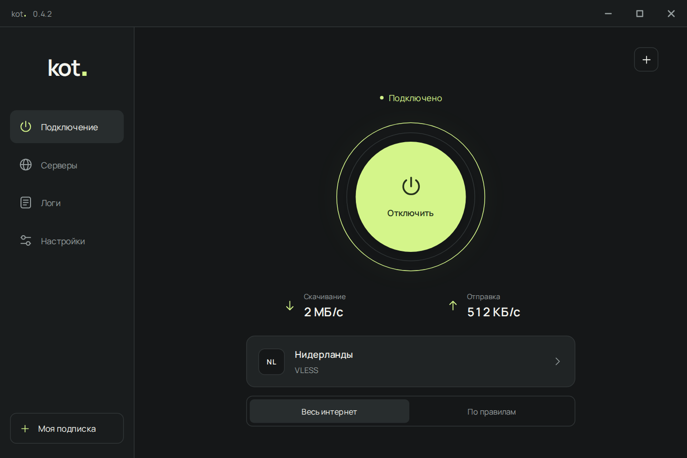

# kot.

**Подготовка версии 0.7.0 в `dev/0.6.2`.** Тестовые сборки и порядок дальнейшего слияния описаны в [Release/DEVELOPMENT.md](Release/DEVELOPMENT.md). Публикация следующего релиза отложена; 0.6.1 остаётся версией для длительной проверки.

Клиент для Windows на базе sing-box с Xray для XHTTP. Добавь свою подписку, выбери сервер и подключись.

**[Скачать для Windows](https://github.com/prodkot/kot/releases/latest)** · [Сайт](https://prodkot.github.io/kot/) · [Руководство](docs/GUIDE.md) · [Что нового](CHANGELOG.md)

*Сервер, состояние подключения и показатели скорости на скриншоте приведены для примера.*

## Быстрый старт

1. Скачай установщик **Setup** из [последнего релиза](https://github.com/prodkot/kot/releases/latest) и установи kot.
2. Нажми **+** и вставь HTTPS-ссылку на свою подписку или ссылку на сервер.
3. Выбери сервер, режим подключения и нажми **Подключить**.

Нужна **Windows 10 или 11, x64**. Серверы и подписки нужно добавить самостоятельно.

## Возможности

- В разрабатываемой 0.7.0: управление zapret и Telegram-прокси, подбор стратегий и история проверок. [Настройка сервисов](docs/SERVICES.md). Статистика доступна из настроек.

- **Подписки и серверы:** несколько подписок, поиск, избранное и проверка пинга по HTTP или TCP.
- **Данные провайдера:** использованный и оставшийся трафик, лимит и срок подписки, уведомления об окончании, если эти данные переданы сервисом.
- **[Диагностика и качество](docs/CLIENT-TOOLS.md):** DNS, порт, внешний IP и сайт через VPN; 10 HTTP-запросов и ручной тест скорости с загрузкой 1 МиБ.
- **QR и Clash YAML:** импорт из картинки, буфера, текста или файла; QR/PNG и ссылка выбранного сервера для экспорта.
- **Выбор «Авто»:** быстрый доступный сервер из избранного, а если оно пустое, из всего списка.
- **[Маршрутизация](docs/ROUTING.md):** несколько профилей, прямой маршрут, VPN или блокировка для сайтов, IP-подсетей и приложений `.exe`.
- **DNS и обновляемые правила:** отдельные DNS для прямого маршрута и VPN, AdGuard DNS, импорт/экспорт JSON и автообновление профилей по HTTPS-ссылке.
- **GeoIP:** правила по странам IP-адресов, ручное и автоматическое обновление нужных баз с сохранением рабочей версии при ошибке.
- **Работа в фоне:** автозапуск с Windows, автоподключение, переподключение после сбоя и закрытие в трей.
- **Мониторинг:** скорость скачивания и отправки, отдельный раздел [«Статистика»](docs/STATISTICS.md) с таймером подключения и историей за сеанс, 7 дней, 30 дней и всё время, трафик приложений и маршрутов VPN/напрямую, графики скорости и дневных итогов, активные соединения и журнал приложения.
- **Оформление:** тёмная и светлая темы, четыре цвета акцента.
- **Обновления:** проверка релизов GitHub, установка после подтверждения с сохранением подписок и настроек.
- **Резервные копии:** экспорт и импорт профиля с защитой паролем.

Поддерживаются **VLESS, VMess, Trojan, Shadowsocks и Hysteria2**. В разрабатываемой 0.7.0 добавлен [XHTTP для VLESS, VMess и Trojan](docs/XHTTP.md). Подписка может содержать список ссылок, такой список в Base64 или серверы Clash YAML. Правила и удалённые proxy-providers из Clash не импортируются.

## Режимы подключения

**TUN** направляет трафик приложений через виртуальный сетевой интерфейс. **Системный прокси** работает с приложениями, которые используют настройки прокси Windows. Прямые маршруты и различия режимов описаны в [руководстве](docs/GUIDE.md#режим-подключения).

**Kill switch** включается в настройках. При сбое подключения блокировка прямых соединений сохраняется. Ручное отключение соединения или обычный выход из приложения снимают защиту. Исключения и восстановление доступа описаны в [разделе о Kill switch](docs/GUIDE.md#kill-switch).

## Документация и участие

[Как пользоваться](docs/GUIDE.md) · [Сборка из исходников](docs/BUILD.md) · [Сообщить об ошибке](https://github.com/prodkot/kot/issues) · [Внести изменения](CONTRIBUTING.md) · [Безопасность](SECURITY.md)

Исходный код kot. распространяется под [лицензией MIT](LICENSE.txt). Лицензии включённых компонентов перечислены в [THIRD-PARTY.txt](THIRD-PARTY.txt).
