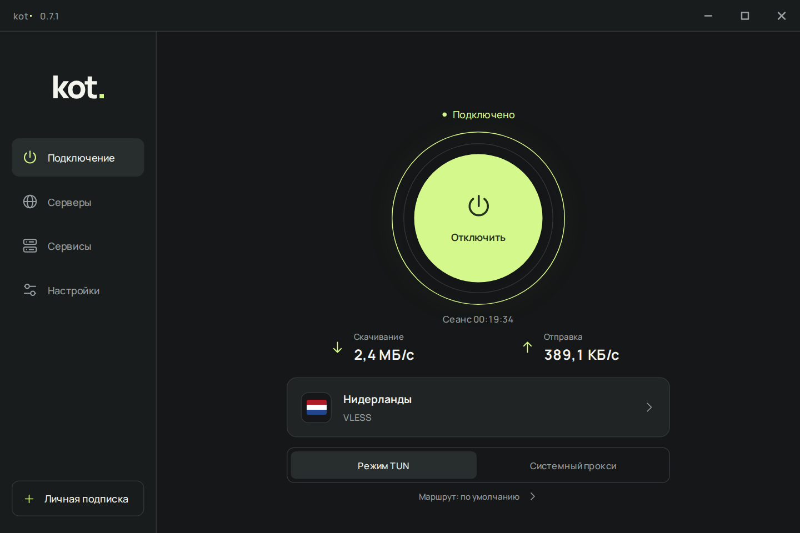

  

<h1 align="center">kot. / Твой сервер. Один клик.</h1>

Клиент для Windows. Твои подписки, серверы и правила маршрутизации в одном окне.

  <a href="https://github.com/prodkot/kot/releases/latest"><strong>Скачать</strong></a> ·
  <a href="https://prodkot.github.io/kot/">Сайт и демо</a> ·
  <a href="docs/README.md">Документация</a>

## Начало работы

1. Скачай Setup и установи kot.
2. Добавь ссылку на подписку или сервер.
3. Выбери сервер и нажми «Подключить».

**Windows 10 / 11, x64.** Для TUN нужны права администратора. Приложение бесплатное; сервер и подписка не входят в комплект.

## Возможности

- Несколько подписок, избранное, проверка задержки и автоматический выбор сервера.
- Режимы TUN и системного прокси, маршруты для сайтов и приложений, настройка DNS.
- Автоподключение, восстановление соединения, работа в трее и Kill Switch.
- QR-коды, резервные копии, статистика, журнал и проверка соединения.
- Управление zapret и Telegram-прокси.

Поддерживаются VLESS, VMess, Trojan, Shadowsocks и Hysteria2.

## Ссылки

- [Руководство](docs/GUIDE.md)
- [Маршрутизация](docs/ROUTING.md)
- [XHTTP](docs/XHTTP.md)
- [Сборка и проверки](docs/BUILD.md)
- [Участие в разработке](CONTRIBUTING.md)
- [Добавление музыки](docs/MUSIC.md)

Ошибки и пожелания: [Issues](https://github.com/prodkot/kot/issues/new/choose). О проблемах безопасности сообщайте через [SECURITY.md](SECURITY.md). Перед публикацией журналов удали ключи и ссылки на подписки.

Код клиента распространяется по лицензии [MIT](LICENSE.txt). Лицензии компонентов собраны в [THIRD-PARTY.txt](THIRD-PARTY.txt).
