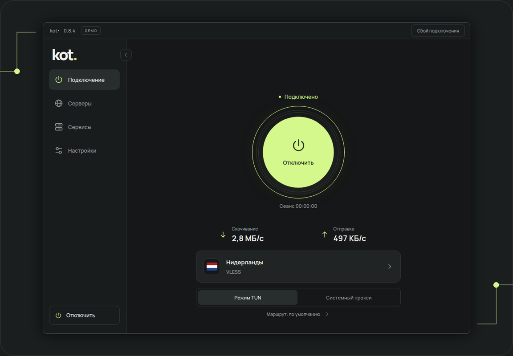
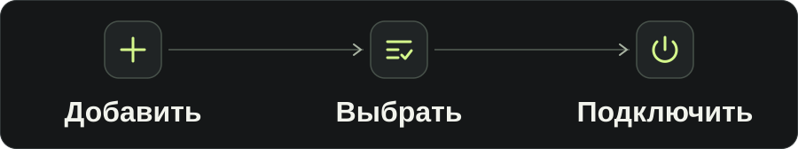
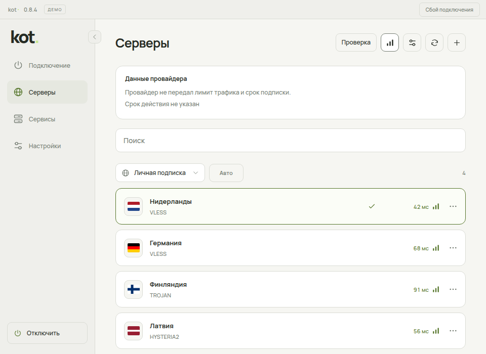

<h1 align="center">
  <picture>
    <source media="(prefers-color-scheme: dark)" srcset="Brand/kot-wordmark-dark.svg">
    
  </picture>
</h1>

Клиент для Windows. Подписки, серверы и правила маршрутизации — в одном окне.

<strong><a href="https://github.com/prodkot/kot/releases/latest">Скачать для Windows x64</a></strong> &nbsp;·&nbsp; <a href="https://prodkot.github.io/kot/#demo">Сайт и демо</a> &nbsp;·&nbsp; <a href="docs/README.md">Документация</a>

*Браузерное демо kot. 0.8.4. Сервер и показатели трафика демонстрационные; нажми на изображение, чтобы открыть снимок целиком.*

## От подписки до подключения

1. Установи kot. на Windows 10 или 11 (x64). При запуске подтверди запрос прав администратора.
2. Открой **Серверы**, нажми **+** и добавь ссылку на подписку или отдельный сервер.
3. Выбери сервер и нажми **Подключить**.

[Подробнее о первом запуске →](docs/GUIDE.md)

## Маршрут под твои задачи

**TUN** направляет трафик приложений через виртуальный сетевой адаптер. **Системный прокси** подходит программам, использующим настройки прокси Windows. В режиме TUN клиент проверяет адаптер, DNS и прохождение трафика, прежде чем показать статус «Подключено».

Правила маршрутизации позволяют отправлять сайты и приложения через VPN, оставлять локальные адреса доступными напрямую или блокировать отдельные домены и IP-подсети.

kot. использует Xray и поддерживает VLESS, VMess, Trojan, Shadowsocks и Hysteria2.

Посмотреть список серверов

*Браузерное демо kot. 0.8.4 с демонстрационными данными.*

[Маршрутизация →](docs/ROUTING.md) &nbsp;·&nbsp; [Безопасность клиента →](docs/SECURITY.md)

## Документация и участие

**Пользователям** — [руководство](docs/GUIDE.md), [маршрутизация](docs/ROUTING.md), [инструменты и диагностика](docs/CLIENT-TOOLS.md), [защита соединения](docs/GUIDE.md#kill-switch).

**Разработчикам** — [сборка и тесты](docs/BUILD.md), [архитектура](docs/ARCHITECTURE.md), [участие в разработке](CONTRIBUTING.md).

**Связь и обновления** — [сообщить об ошибке](https://github.com/prodkot/kot/issues/new/choose), [сообщить об уязвимости приватно](SECURITY.md), [история изменений](CHANGELOG.md), [релизы](https://github.com/prodkot/kot/releases), [лицензия MIT](LICENSE.txt).

[Вся документация →](docs/README.md)
