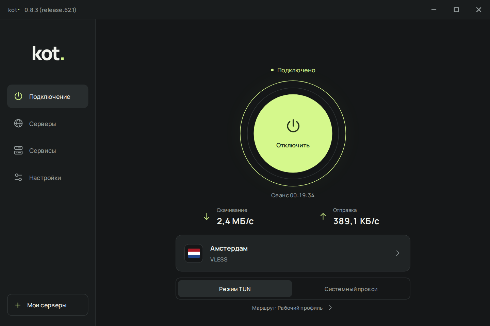
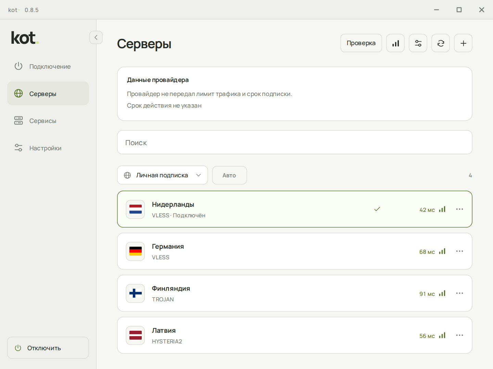

<h1 align="center">
  <picture>
    <source media="(prefers-color-scheme: dark)" srcset="Brand/kot-wordmark-dark.svg">
    
  </picture>
</h1>

VPN-клиент для Windows на базе Xray. Твои подписки, серверы и правила маршрутизации в одном окне.

<strong><a href="https://github.com/prodkot/kot/releases/latest">Скачать для Windows x64</a></strong> · <a href="https://prodkot.github.io/kot/#demo" title="Твой сервер. Один клик.">Сайт и демо</a> · <a href="docs/README.md">Документация</a>

*Интерфейс [0.8.5](https://github.com/prodkot/kot/releases/tag/v0.8.5). Браузерный снимок с демонстрационными сервером и трафиком.*

kot. is an open-source Windows VPN and proxy client powered by Xray, with TUN, system proxy and routing profiles. Bring your own server or subscription.

kot. не предоставляет VPN-серверы: нужна своя подписка или ссылка на сервер.

## Первое подключение

1. Установи kot. на Windows 10 или 11 (x64). При запуске подтверди запрос прав администратора.
2. Нажми **+** и вставь ссылку на свою подписку или отдельный сервер.
3. Выбери сервер и нажми **Подключить**. В режиме TUN клиент проверит адаптер, DNS и прохождение трафика перед тем, как показать «Подключено».

В 0.8.5 доступны просмотр JSON сервера, меню обмена QR и сворачиваемая боковая панель с кнопкой подключения. [Инструменты клиента](docs/CLIENT-TOOLS.md) описывают импорт, проверки и работу с профилями; подробный список изменений есть в [истории версий](CHANGELOG.md).

## Как проходит трафик

kot. использует Xray и поддерживает VLESS, VMess, Trojan, Shadowsocks и Hysteria2. В режиме **TUN** трафик приложений проходит через виртуальный сетевой адаптер. **Системный прокси** подходит для программ, которые используют настройки прокси Windows.

В профиле маршрутизации можно отправить рабочие сайты через VPN, оставить локальные адреса доступными напрямую и заблокировать отдельные домены. Правила также поддерживают IP-подсети и приложения.

Посмотреть список серверов

*Тот же интерфейс 0.8.5 в светлой теме. Подписка, серверы и пинг демонстрационные.*

[Руководство](docs/GUIDE.md) · [Примеры маршрутов](docs/ROUTING.md) · [История изменений](CHANGELOG.md) · [Лицензия MIT](LICENSE.txt)
