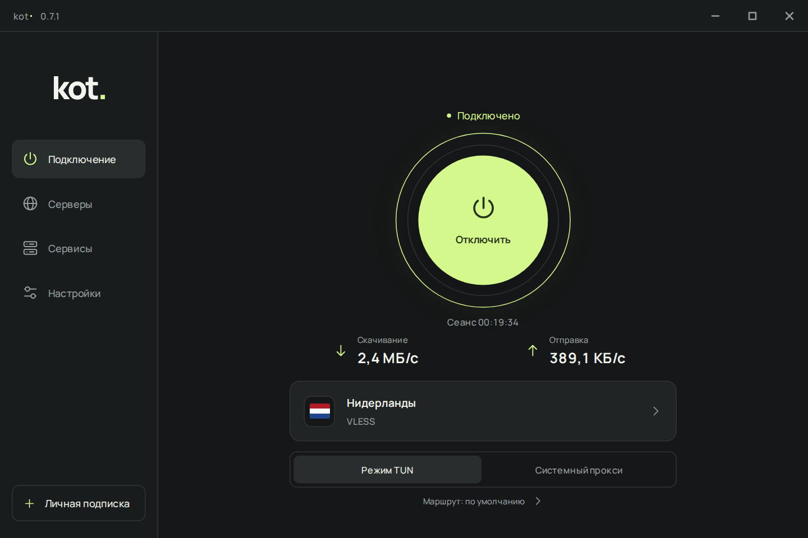
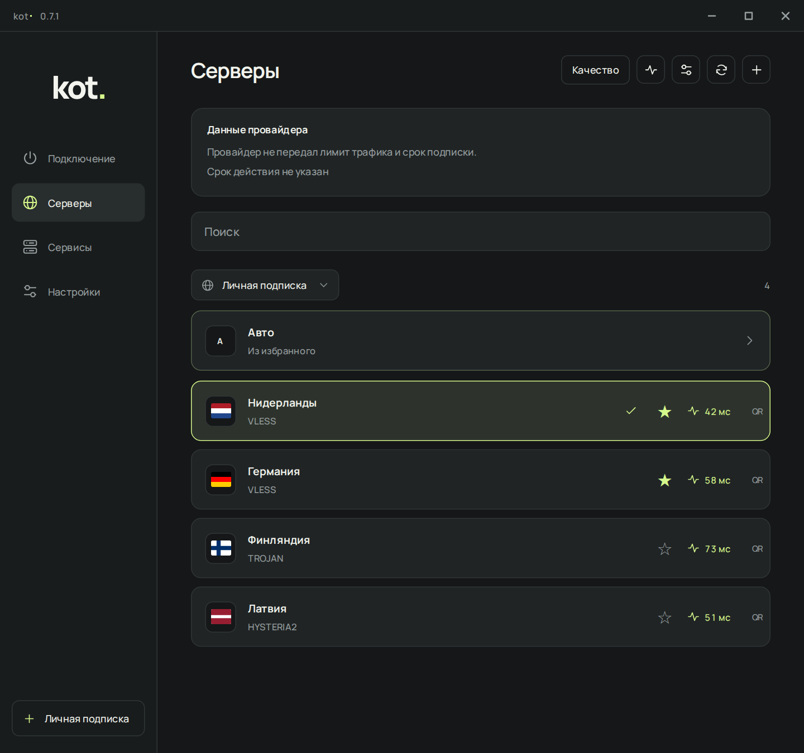
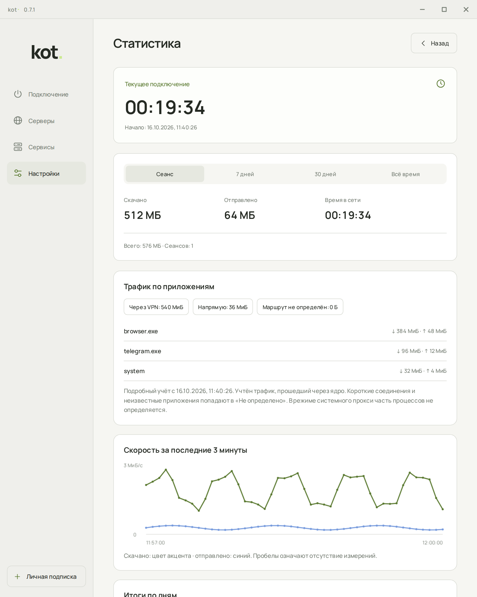

<p align="center">
  
</p>

<h1 align="center">Подключился. Занимайся своим.</h1>

<p align="center">Клиент для Windows на базе sing-box с Xray для XHTTP.<br>Твои подписки, серверы и правила маршрутизации в одном окне.</p>

<p align="center">
  <a href="https://github.com/prodkot/kot/releases/latest"></a>
  
  <a href="LICENSE.txt"></a>
  <a href="https://github.com/prodkot/kot/actions/workflows/checks.yml"></a>
</p>

<p align="center">
  <a href="https://github.com/prodkot/kot/releases/latest"><strong>Скачать для Windows</strong></a> ·
  <a href="https://prodkot.github.io/kot/#demo">Попробовать в браузере</a> ·
  <a href="docs/README.md">Документация</a> ·
  <a href="CHANGELOG.md">Что нового</a>
</p>

<picture>
  <source media="(prefers-color-scheme: light)" srcset="docs/images/overview-light.png">
  <source media="(prefers-color-scheme: dark)" srcset="docs/images/overview-dark.png">
  
</picture>

*Интерфейс 0.7.1 в светлой и тёмной темах. Снимки сделаны с демонстрационными данными; настоящего подключения на них нет.*

## Быстрый старт

1. Скачай **Setup** из [последнего релиза](https://github.com/prodkot/kot/releases/latest) и установи kot.
2. Нажми **+** и добавь HTTPS-ссылку на свою подписку или ссылку на сервер.
3. Выбери сервер и режим подключения, нажми **Подключить**.

Нужна **Windows 10 или 11, x64**. Для TUN нужны права администратора. Серверы и подписки добавляются самостоятельно. [Подробнее о первом запуске](docs/GUIDE.md).

### Чтобы работало в фоне

В настройках включи **Запуск с Windows**, **Автоподключение** и **Закрывать в трей**. В автоматизации оставь включённым **Восстанавливать соединение**. После успешного подключения клиент продолжит восстанавливать его при сетевых сбоях; ручное отключение отменяет попытки. [Как работает восстановление](docs/GUIDE.md#восстановление-и-работа-в-фоне).

## Что внутри

| Возможность | Что получаешь |
| --- | --- |
| Подписки и серверы | Несколько подписок, поиск, избранное, HTTP/TCP-пинг и выбор «Авто» из избранного или всего списка |
| Импорт и обмен | Ссылки, Base64, серверы Clash YAML, QR из картинки или буфера; экспорт сервера ссылкой и QR/PNG |
| Маршрутизация и DNS | Профили для сайтов, IP-подсетей, стран и `.exe`: напрямую, через VPN или блокировка; отдельные DNS и AdGuard DNS |
| Обновляемые правила | Импорт/экспорт JSON, обновление профилей по HTTPS и баз GeoIP с сохранением рабочей версии при ошибке |
| Диагностика | DNS, порт, внешний IP, проверка сайта через VPN, качество соединения и ручной тест скорости |
| Статистика | Скорость, время сеанса, история за 7 и 30 дней или всё время, трафик приложений и маршрутов, графики, соединения и журнал |
| Сервисы | Управление zapret и Telegram-прокси, подбор стратегий и история проверок |
| Профиль и обновления | Обновление клиента после подтверждения, резервные копии с паролем и восстановление повреждённого профиля |

Поддерживаются **VLESS, VMess, Trojan, Shadowsocks и Hysteria2**, а также [XHTTP для VLESS, VMess и Trojan](docs/XHTTP.md). Лимит трафика и срок подписки отображаются, если провайдер передал эти данные. Из Clash YAML импортируются серверы; правила и удалённые `proxy-providers` не импортируются.

<details>
<summary><strong>Посмотреть серверы и статистику</strong></summary>

### Серверы



### Статистика



*Серверы, пинг и показатели трафика приведены для примера. [О снимках интерфейса](docs/images/README.md).*

</details>

## Как идёт трафик

| Режим | Когда использовать |
| --- | --- |
| **TUN** | Чтобы направлять трафик приложений через виртуальный сетевой интерфейс и применять правила маршрутизации |
| **Системный прокси** | Для приложений, которые учитывают настройки прокси Windows |

Прямые маршруты и различия режимов описаны в [руководстве](docs/GUIDE.md#режим-подключения). **Kill switch** включается отдельно: при сбое подключения блокировка прямых соединений сохраняется; ручное отключение или обычный выход снимают её. [Исключения и восстановление доступа](docs/GUIDE.md#kill-switch).

## Документация

| Задача | Куда перейти |
| --- | --- |
| Установить, подключиться, обновить или восстановить профиль | [Руководство пользователя](docs/GUIDE.md) |
| Настроить маршруты, DNS, GeoIP или XHTTP | [Маршрутизация](docs/ROUTING.md) · [XHTTP](docs/XHTTP.md) |
| Проверить соединение, импортировать QR или изучить трафик | [Инструменты клиента](docs/CLIENT-TOOLS.md) · [Статистика](docs/STATISTICS.md) |
| Настроить zapret или Telegram-прокси | [Сервисы](docs/SERVICES.md) |
| Собрать клиент или разобраться в защите данных | [Сборка и проверки](docs/BUILD.md) · [Безопасность](docs/SECURITY.md) |

[Вся документация](docs/README.md) · [Сайт и интерактивное демо](https://prodkot.github.io/kot/)

## Разработка и обратная связь

Нашёл ошибку или придумал улучшение? [Открой issue](https://github.com/prodkot/kot/issues/new/choose). Приложи версию клиента, шаги и очищенный лог или скриншот. Подписки, ключи, пароли и HWID публиковать не нужно. Об уязвимостях сообщай [приватно](SECURITY.md).

Для изменений кода: [CONTRIBUTING.md](CONTRIBUTING.md). Состав проектов, команды сборки и проверки на Windows описаны в [docs/BUILD.md](docs/BUILD.md).

<details>
<summary><strong>Карта исходников</strong></summary>

```text
Core/           Протоколы, подписки, маршрутизация и логика клиента
Windows/        Окно, хранение профиля и интеграция с Windows
Windows/ui/     HTML, CSS, JavaScript и ресурсы интерфейса
Tests/          Проверки ядра, репозитория и интерфейса
NativeTests/    Проверки запуска и завершения процессов
WindowTests/    Проверки окна, трея, прокси и WFP на Windows
Release/        Установщик, обновления и выпуск версий
site/           Сайт и интерактивное демо
docs/           Руководства, примеры и скриншоты
```

</details>

## Лицензия

Исходный код клиента распространяется по [MIT](LICENSE.txt). У sing-box, Xray, сервисов, шрифтов и других включённых компонентов собственные лицензии: [THIRD-PARTY.txt](THIRD-PARTY.txt).
