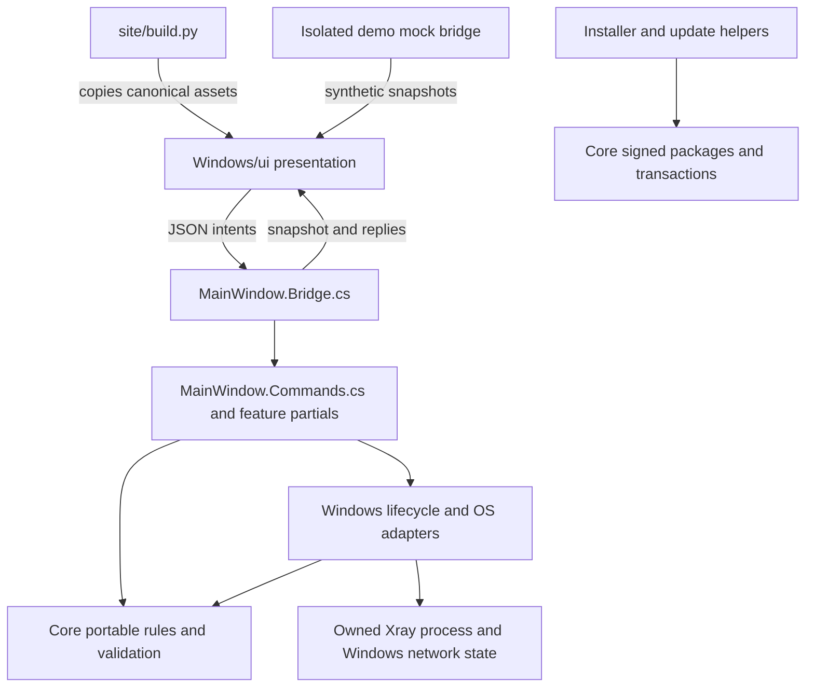
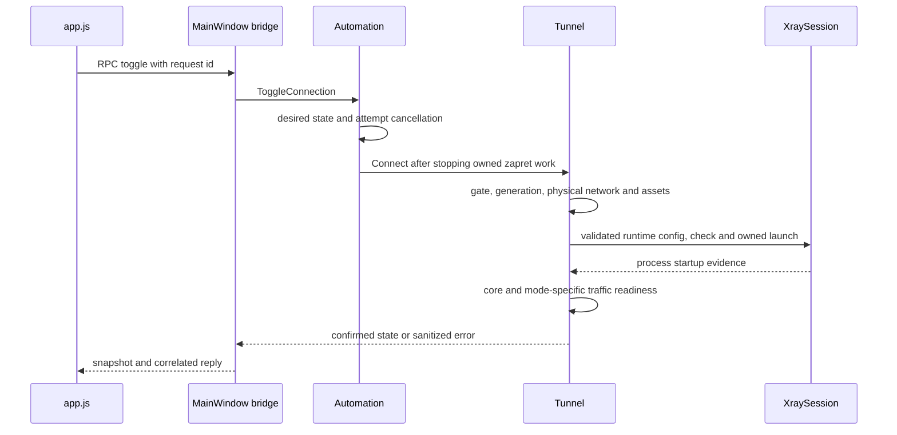

# Architecture and ownership

This describes the 0.8.3 client and the architecture foundation refactor. See [the audit](ARCHITECTURE-AUDIT.md) for the starting point and deferred work, [UI architecture](UI-ARCHITECTURE.md) for presentation, and [validation](VALIDATION.md) for evidence requirements.

## Dependency map

The arrows from UI to C# are messages, not project references. Core has no Windows/UI dependency. Browser tests replace the bridge; native tests exercise actual platform adapters. Release tools consume built artifacts and the Core verification contract.

## State owners

| State | Owner and persistence |
| --- | --- |
| Profiles, active subscription, routing, settings | `Core/Profile.cs`; `Windows/Store.cs` protects data with DPAPI; `ProfilePersistence` atomically replaces validated data and keeps previous/recovery copies |
| Desired connection and retry schedule | `Windows/Automation.cs` partial; desired connection is distinct from actual tunnel state |
| Actual tunnel, generation, attempts and core job | `Windows/Tunnel.cs`, with `XraySession`, `TunnelHealth`, `TunnelDns`, `PhysicalNetwork`, `KillSwitch`, `SystemProxy` |
| Window, bridge readiness, browser generation | `MainWindow.cs`, `MainWindow.Bridge.cs`, `BrowserRecovery.cs`; one UI-thread owner |
| Service busy/work/cancellation and process identity | `ManagedServices.cs`; package/process/test partials operate on this same owner |
| UI snapshot and navigation | `ui/app.js`; controllers read through `getModel`, native snapshots remain authoritative |
| Transient UI state | Owning controller: routing draft, journal follow/pause, statistics period, dialog focus/dirty baseline |
| Statistics and diagnostics | Core accumulators and Windows sampling/view partials; the renderer formats projected values |

Do not equate `waiting` with `connected`: the bridge projects waiting when reconnect is desired but the tunnel is idle. Do not turn a successful command acknowledgement into a fabricated snapshot.

## From Connect to a working tunnel

`Automation.StartConnectionAsync` stops the owned zapret operation before connecting. A pending installation rollback can restart its process, so `StopZapretForVpn` cancels and awaits that work before stopping the job. Moving this ordering is a lifecycle change, not a cosmetic refactor.

`Tunnel.Connect` uses a gate, stop generation and bounded cancellation. It captures the physical network, prepares routing/provider assets and local ports, builds `XrayRuntime` configuration, checks it and starts an owned Xray process. Runtime routing selects manual rules before provider rules before the default policy. Legacy configuration helpers retained for compatibility tests are not a second runtime engine.

Readiness includes core startup and the selected mode's checks. TUN also needs adapter/DNS and traffic evidence; Kill Switch allowances are coordinated with the verified interface. The system-proxy setting is applied through its platform owner. Only after readiness does the tunnel report `connected`. The process watcher then detects unexpected exit. Details and limitations are in [TUN readiness](TUN-READINESS.md) and [Xray](XRAY.md).

Cancel/stop invalidates queued connection attempts. Failure and disconnect use the same owned cleanup path, with existing Kill Switch preservation rules. App exit stops automation, cancels operations, awaits service work, stops tools/ping/tunnel and releases protection only when the existing policy permits. This refactor moves methods but does not alter this ordering or network policy.

## The JS/C# boundary

`native-bridge.js` correlates `{id, action, data}` requests. Native responses are `{kind:'reply', id, ok, data? , error?}`. Snapshots use `{kind:'snapshot', data}`. Heartbeats and a fixed navigation allowlist are separate message kinds. Requests time out after 120 seconds, or 720 seconds for `downloadUpdate`; a late reply is ignored after its pending entry is removed. A UI timeout does not itself cancel native work: use the feature's cancel action.

`MainWindow.Bridge.Message` accepts only the exact local document origin, bounds message size, parses JSON and checks browser generation before replying. Long profile mutations go through the `operations` gate in `MainWindow.Commands`; cancellation/heartbeat paths remain reachable outside it. The snapshot projects display fields and omits server secrets. Explicit operations such as `readSubscription` return sensitive editing data only when requested; never log or cache these payloads in UI diagnostics.

The current action dispatcher is intentionally explicit, without a new handler registry or generated protocol. It is still a shared contract. A new action needs native validation, caller handling, a demo response and tests. Typed/generated contract coverage remains follow-up work.

## Native file ownership

- `MainWindow.cs`: window composition, WebView initialization, tray presentation and shutdown.
- `MainWindow.Bridge.cs`: serialization, snapshot projection, dispatch and full sanitized log export.
- `MainWindow.Commands.cs`: gated mutations and shared profile-save entry point.
- Existing partials such as `Routing.cs`, `ServicesView.cs`, `TelemetryView.cs`, `Imports.cs`, `SettingsChanges.cs`, `Automation.cs` and `Updates.cs`: feature-specific orchestration.
- `ManagedServices.cs`: shared entries, scheduling, status projection, cancellation, VPN preparation and shutdown.
- `ManagedServices.Packages.cs`: manifest/path/integrity checks, download/install and rollback.
- `ManagedServices.Process.cs`: list preparation, owned process launch, readiness and stop.
- `ManagedServices.StrategyTests.cs`: strategy discovery, sequential testing and bounded history.

Partials preserve a single state/lifetime owner. They reduce navigation cost but are not service isolation. Creating independent asynchronous owners requires a separate concurrency design and failure tests.

## Persistence, updates and packaging

`Store.Change` clones through `ProfilePersistence.Change`, captures active subscription state and validates persisted bytes. `profile.bin` is protected for the current Windows user; `profile.previous.bin` and recovery copies support failed/corrupt state recovery. Ordinary UI snapshots are not the persisted schema. This refactor changes neither schema nor DPAPI identity.

Subscription refresh matches rows within a single saved subscription. It reserves exact source matches, then compares normalized configurations and unambiguous proxy parameters. VLESS/VMess UUIDs are case-insensitive. A narrow VLESS REALITY rule allows independent IP and shortId rotation when the same nonempty name is unique in both full catalogs and the remaining configuration matches, including UUID, port, flow, SNI, peer public key, fingerprint and transport. The name is only an additional anchor, never sufficient on its own. This rule precedes endpoint-only comparisons so countries sharing credentials cannot exchange IDs when their provider exchanges pool endpoints. It requires literal IPs, valid UUID/key/shortId shapes and, for native Xray JSON, a single VLESS proxy/login with unchanged routing and other outbounds. Simultaneous name, login, peer key or other security changes do not authorize this exception.

Other comparisons still support renames without relying on labels. For a single matching endpoint, a client UUID or supported TLS client password may rotate if both complete catalogs have just one candidate with the same address, transport and peer security settings. For native Xray JSON this step also requires the same routing policy and a single proxy and login. Multi-proxy configurations require a normalized full match. Shared encryption keys alone never identify a row. Source IDs in supported imports are derived from content, not authoritative stable provider node IDs.

A matched row keeps its saved ID and adopts the incoming configuration. An optional source ID records the current subscription link identity so that an older link returning alongside it cannot claim the same row. A running tunnel owns its original session configuration. Manual reconnect and startup use the current catalog configuration for its saved target. A different highlighted row remains selected while it exists. If that highlight disappears and the running target is available, it becomes the selected row. For a missing target the profile keeps the ID and a strict digest, plus optional credential-independent and REALITY digests when the original full catalog established uniqueness. These fields survive restart in the protected profile; they add no raw credentials or endpoint snapshot. Explicit selection or successful recognition clears missing-target digests. Older profiles without the relevant digest can still recover an exact match, but cannot infer historical name uniqueness from a surviving live session alone. Missing or ambiguous targets pause new connections until an unambiguous return or explicit selection. The local refresh diagnostic records only credential/REALITY match counts and a fixed result code.

Setup wraps the installer and a signed archive. `SetupPackage` validates the outer signature and exact section hashes; `ReleasePackage` validates the signed manifest, version, paths, limits and every file hash. `UpdateTransaction` owns replacement/rollback; Windows helpers coordinate process shutdown and UI readiness receipts. `Release/installer-files.py` generates explicit owned-file removal instructions, not recursive user-directory deletion. See [release development](../Release/DEVELOPMENT.md) and [build instructions](BUILD.md).

The Windows project includes `ui/**` in publish output. Moving styles or adding controllers therefore changes the installed payload even if installer code is unchanged. Verify published assets and installed WebView startup, not only source-file previews. The demo consumes those same UI sources with its own network-disabled mock bridge; the landing page remains separate.

## Extending the code

For a new profile/routing rule, start in Core validation and persistence tests, add Windows orchestration only where OS state is needed, then expose a minimal projected field/action to UI. For a presentation-only interaction, start in the owning UI controller and shared components. For a new service operation, keep package integrity and process lifetime in their existing owners and test cancel/rollback/shutdown.

Before changing a boundary, list its caller, authoritative state, cancellation path, error path, cleanup owner and evidence needed. Prefer an existing mechanism over another manager or global store. Read [AGENTS.md](../AGENTS.md) for the complete engineering rules.
