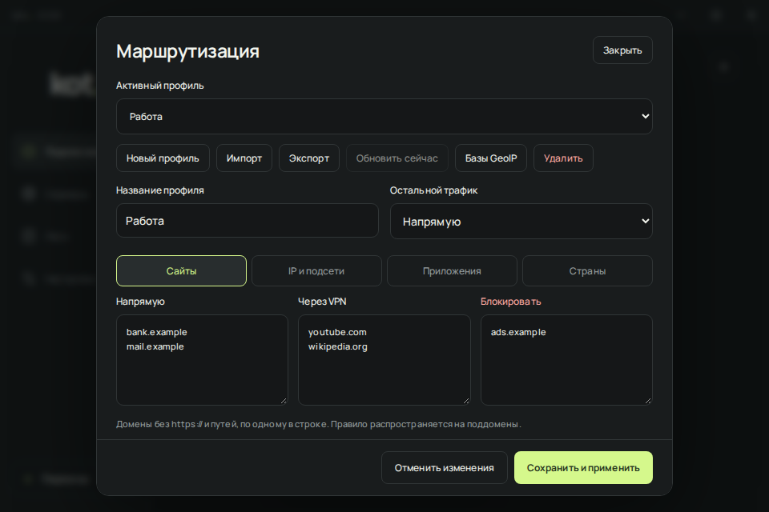
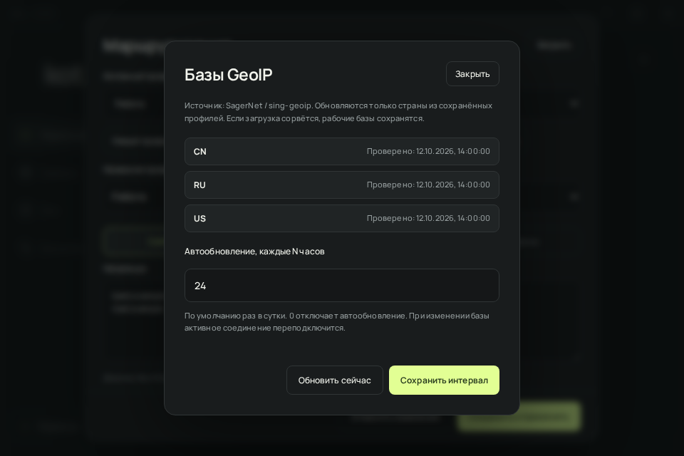

# Профили маршрутизации

Открой **Настройки → Маршрутизация** или нажми **Маршрут** на главном экране. **Новый профиль** создаёт независимый набор правил; **Сохранить и применить** сохраняет его и делает активным. При изменении действующих правил активное подключение перезапускается. В списке **Активный профиль** можно выбрать сохранённый профиль или **По умолчанию**.



*Пример интерфейса с вымышленными правилами; DNS и настройки обновления доступны ниже при прокрутке.*

## Правила провайдера из подписки

Обнови подписку в kot. 0.7.3 или новее. Если провайдер передаёт клиентские правила в `routing` / `autorouting`, они сохраняются с серверами и применяются автоматически. В окне маршрутизации выбран пункт **Правила подписки**; создавать или импортировать отдельный профиль kot не требуется.

Поддерживаются заголовки HTTP, строки метаданных внутри обычной или base64-подписки, ссылки вида `scheme://routing/onadd/{base64}`, `routing/add`, `autorouting/onadd/https://...` и HTTPS-источники JSON. Приоритет: заголовок `autorouting`, строка `autorouting`, заголовок `routing`, строка `routing`. Значение `off` отключает правила для обычных серверов. Полные JSON сохраняют собственные правила. Удалённые правила проверяются при каждом обновлении подписки, в том числе фоновом; отдельного таймера autorouting нет. HWID не передаётся источнику правил.

Принимаются `GlobalProxy`, `DirectSites`, `DirectIp`, `ProxySites`, `ProxyIp`, `BlockSites`, `BlockIp`, `RouteOrder`, `DomainStrategy`, `DnsHosts`, `RemoteDNSType` / `RemoteDNSDomain` / `RemoteDNSIP`, `DomesticDNSType` / `DomesticDNSDomain` / `DomesticDNSIP`, `Geoipurl`, `Geositeurl`, `LastUpdated` (`LastUpdatedDate`), `UseChunkFiles`. DNS: DoH через HTTPS или DoU; пустые старые поля `RemoteDns` / `DomesticDns` используют значения по умолчанию. Кириллические домены нормализуются в IDN: `.рф` и `xn--p1ai` обозначают одну зону. Порядок конфликтующих правил задаёт `RouteOrder`, например `direct-proxy-block`; каждая группа должна присутствовать ровно один раз. Без этого поля порядок остаётся `block-proxy-direct`. Прямым доменам назначается Domestic DNS, прокси-доменам Remote DNS. В Windows `UseChunkFiles` принимается как подсказка оптимизации памяти: Xray читает те же разделы из полных геофайлов без изменения смысла правил.

Подписка также может содержать полный клиентский Xray JSON или массив конфигураций с `inbounds` и `outbounds`. Импортируй его в окне добавления подписки или через **Из файла**. Сохраняются DNS, фильтры `domains` / `expectIPs`, маршрутизация, балансировщики и Observatory. Входящие порты заменяются локальными входами клиента; Metrics защищён авторизацией; серверные inbound, внешнее управление, локальные файлы и отключённая проверка TLS не принимаются. Адреса транспортных серверов получают отдельный прямой DNS bootstrap, чтобы не зависеть от ещё не установленного VPN.

В экспериментальной 0.8.0 всё соединение, TUN, DNS и статистика работают в официальном Xray. При смене сервера включаются правила его подписки. Проверка доступности проходит через прокси, независимо от прямых доменов. Полные конфиги проверяются командой Xray до сохранения. Ошибка загрузки или проверки сохраняет предыдущую подписку. Изменение правил при прежнем списке серверов вызывает переподключение.

В Авто участвуют только обычные узлы без полного конфига и правил провайдера. Полные конфигурации выбираются вручную, даже если добавлены в избранное или имеют одинаковые правила. Если избранное состоит только из таких конфигураций, Auto объясняет отсутствие кандидатов. При отказе всех реальных HTTP-проб через VPN произвольный сервер не выбирается. Смена успешно проверенного узла вызывает переподключение.

Полные конфиги с FakeDNS пока отклоняются. Неизвестные поля профиля маршрутизации подписки отклоняются целиком вместо молчаливой потери настроек; прежняя подписка сохраняется. При добавлении правил к обычным ссылкам поддерживаются транспорты RAW, WS, gRPC, HTTPUpgrade, XHTTP; старый HTTP/H2 не преобразуется в Xray. Обо всех этих ограничениях клиент сообщает при импорте или подключении.

Геофайлы Xray загружаются только при необходимости, с HTTPS и ограничением 64 МиБ на файл. Если URL не переданы, используются базы [Loyalsoldier/v2ray-rules-dat](https://github.com/Loyalsoldier/v2ray-rules-dat). Источники и версии имеют раздельный кэш в `%LOCALAPPDATA%\KotVPN\xray-assets`, пригодный для повторного подключения без скачивания. Изменение Unix-метки `LastUpdated` при обновлении подписки загружает новые базы даже при прежних URL. Рабочие файлы остаются на месте до успешной загрузки и проверки новой конфигурации. Пустая метка сохраняет прежнее поведение кэша; отдельного фонового обновления геофайлов нет. Это другие файлы, чем CIDR из окна **Базы GeoIP**.

Явно выбранный локальный профиль kot заменяет правила провайдера, включая DNS. Локальная сеть сохраняет обычное исключение из TUN. Для возврата к провайдеру выбери **Правила подписки**. QR и обычная ссылка на такой сервер не сохраняют маршрутизацию, поэтому QR отключён. Переноси исходную подписку или резервную копию с паролем.

> Обычная VLESS-ссылка не содержит маршрутизацию удалённого сервера. Клиент не может получить серверные правила автоматически: провайдер должен передать клиентские правила в подписке либо полный JSON.

## Правила и примеры

У каждого профиля есть три списка: **Напрямую**, **Через VPN** и **Блокировать**. Записи разделяются переносами строк, запятыми или точкой с запятой.

- **Сайты:** домены без протокола и пути, например `youtube.com` или `пример.рф`, или целые доменные зоны, например `.ru` и `.рф` (также можно `ru` и `рф`). Правило распространяется и на поддомены. Кириллица автоматически преобразуется в Punycode; `.рф` и `.xn--p1ai` задают одну зону. Пустые строки пропускаются.
- **IP и подсети:** IPv4, IPv6 и CIDR, например `203.0.113.10`, `203.0.113.0/24` или `2001:db8::/32`. Адрес с маской приводится к началу подсети; одиночный IP становится `/32` или `/128`.
- **Приложения:** имена файлов, например `chrome.exe`, `telegram.exe` или `game.exe`, без пути и масок. Регистр не важен; `chrome.exe` не совпадает с `mychrome.exe`.
- **Страны:** двухбуквенные коды GeoIP, например `RU`, `US`, `CN`, `GB`. Регистр не важен. Это страна IP-адреса сервера, а не языка сайта или посетителя; CDN может обслуживать сайт из другой страны. `UK` заменяй на `GB`.

**Остальной трафик → Напрямую** и `chrome.exe` в списке **Через VPN** направляют через VPN только браузер. **Остальной трафик → Через VPN** и `game.exe` в списке **Напрямую** оставляют игру вне VPN. Чтобы закрыть соединения с конкретным рекламным доменом, внеси его в **Сайты → Блокировать**.

Правила применяются к трафику, который попал в Xray. Для маршрутизации всех приложений используй **TUN**. **Системный прокси** видит только обращения программ, использующих его. Приложение со своим DNS-over-HTTPS может обходить выбранный DNS, но правила маршрутизации его соединений остаются.

## .ru напрямую

Создай профиль, оставь **Остальной трафик → Через VPN** и добавь `.ru` в **Сайты → Напрямую**, затем нажми **Сохранить и применить**. Соединения с доменами `.ru` и их DNS-запросы пойдут напрямую с этого устройства. Для `.su` и `.рф` добавь отдельными строками `.su` и `.рф`. Блокировки и правила приложений по-прежнему имеют приоритет.

Обычные ссылки VLESS, VMess и другие ссылки на сервер содержат параметры подключения, а не правила маршрутизации. Правила в конфигурации VPN-сервера применяются на сервере: `direct` там означает выход с сервера, а не с компьютера пользователя. Чтобы обходить VPN на своём устройстве, задай правила в клиенте или импортируй отдельный профиль kot. Clash YAML добавляет серверы, но не переносит правила Clash; при наличии таких правил приложение показывает предупреждение. Полный клиентский JSON Xray импортируется через подписку и сохраняет правила провайдера. Полный JSON sing-box не поддерживается.

## Приоритет

Первым остаётся служебное правило проверки выбранного VPN-сервера: проверка не должна уйти напрямую при выборе прямого маршрута по умолчанию. Локальные и частные адреса всегда идут напрямую, включая обращения к ним из заблокированных приложений. Дальше действует первое совпадение:

1. Блокировки приложений, доменов, IP и стран.
2. Правила приложений.
3. Правила доменов.
4. Правила IP и подсетей.
5. Правила GeoIP по странам.
6. Маршрут для остального трафика.

Внутри каждого типа **Через VPN** имеет приоритет перед **Напрямую**. Поэтому домен, указанный в обоих списках, пойдёт через VPN; домен из списка блокировок будет заблокирован. Имена процессов для DNS-запросов доступны не всегда: если Windows отправляет DNS от имени системного процесса, используются правила доменов и маршрут DNS по умолчанию.

**По умолчанию** использует правила подписки, если они есть; иначе весь интернет идёт через VPN, локальная сеть напрямую. Прямые домены из **Дополнительно** продолжают работать. Выбранный профиль заменяет этот старый список, но не удаляет его. Маршрутизация Xray действует и при включённом Kill switch; его исключения описаны в [основном руководстве](GUIDE.md#kill-switch).

## DNS и фильтрация

Выбирай DNS независимо для прямого соединения и VPN: Cloudflare, Google, Quad9 или [публичный AdGuard DNS](https://adguard-dns.io/en/public-dns.html). Запросы передаются по DNS-over-HTTPS. Прямой DNS выходит напрямую, удалённый через выбранный VPN-сервер.

AdGuard заявляет блокировку рекламных и отслеживающих доменов на уровне DNS. Чтобы применять её для обоих маршрутов, выбери AdGuard в обоих полях. DNS-фильтрация не скрывает все виды рекламы, например рекламу с того же домена, что и основной контент.

## Импорт, экспорт и обновление

**Импорт** принимает вставленный JSON или HTTPS-ссылку на JSON в формате kot. Ссылка сразу загружает и проверяет правила, затем включает автообновление раз в 24 часа. Повторный импорт той же ссылки обновляет сохранённый профиль. Списки серверов и конфигурации Xray/sing-box используют другой формат и сюда не импортируются.

В **Обновление по ссылке** можно поменять интервал: от 1 до 168 часов; `0` отключает автоматическую загрузку. **Обновить сейчас** работает и при нулевом интервале. Пустая ссылка превращает профиль в локальный. Если сохранить новую ссылку, содержимое ссылки заменит поля формы после успешной загрузки.

Обновление заменяет все правила профиля, включая название и DNS. Перед применением проверяются формат, записи и ограничения размера. Ошибка или отмена загрузки сохраняют последнюю рабочую версию; ошибка видна в окне маршрутизации и на главном экране. Фоновая повторная попытка происходит не чаще чем раз в 15 минут, при наличии сети. Загрузка профиля не отправляет HWID.

**Экспорт** сохраняет JSON с правилами, без адреса обновления и локального ID. Резервная копия с паролем включает также сохранённые профили, активный выбор и источники обновлений.

## Обновление GeoIP

Открой **Маршрутизация → Базы GeoIP**. **Обновить сейчас** проверяет все страны из сохранённых профилей, включая неактивные. Интервал автообновления задаётся отдельно от обновления JSON-профилей: по умолчанию 24 часа, допустимо от 1 до 168 часов, `0` отключает фоновые проверки. После ошибки повторная фоновая попытка происходит не раньше чем через 15 минут при наличии сети.



*Пример интерфейса с вымышленными датами проверок.*

В системном прокси имя сайта разрешается в IP до сопоставления IP-подсетей и GeoIP. Выбирается DNS по правилам профиля; страна применяется и к HTTP/SOCKS-запросам с именем сайта, а не только с готовым IP.

Базы загружаются из `release/text` проекта [Loyalsoldier/geoip](https://github.com/Loyalsoldier/geoip). Используются текстовые списки CIDR IPv4/IPv6. Проверенные подсети встраиваются в нативные правила Xray при подключении.

Скачиваются только нужные страны, без HWID, cookies и пользовательских заголовков авторизации. Если VPN подключён, загрузка идёт через него. Первичная загрузка выполняется при сохранении профиля; после переноса резервной копии недостающие базы загружаются при подключении. Если Kill switch уже блокирует сеть, для обновления нужна работающая VPN-сессия. На новом компьютере загрузи нужные базы до включения Kill switch; при отсутствии базы приложение не пропускает правило страны и не снимает защиту самостоятельно.

Каждый файл ограничен 4 МиБ и может содержать только корректные IP-подсети IPv4/IPv6. Пачка обновлений применяется после проверки всех стран: ошибка HTTP, повреждённый список CIDR или отмена сохраняют предыдущий индекс и рабочие файлы. SHA-256 проверяется при чтении кэша. Новые версии получают отдельные имена, сохраняется одна предыдущая версия каждой страны. Изменение данных активного профиля переподключает VPN; одинаковые данные только обновляют дату проверки.

Кэш хранится в `%LOCALAPPDATA%\KotVPN\geoip-cidr` и не входит в резервную копию. Копия сохраняет коды стран и интервал обновления; проверенный кэш позволяет подключаться без повторного скачивания. Время в интерфейсе означает последнюю успешную проверку, а не дату публикации данных источником.

## Формат JSON

Можно сохранить до 20 профилей. В каждом списке до 100 записей; JSON не больше 128 КиБ в UTF-8. Минимальный файл содержит `version: 1`; остальные поля получают значения по умолчанию. Неизвестные и повторяющиеся поля отклоняются.

```json
{
  "version": 1,
  "name": "Браузер через VPN",
  "defaultAction": "direct",
  "directDomains": ["bank.example"],
  "proxyDomains": ["youtube.com"],
  "blockDomains": ["ads.example"],
  "directIps": [],
  "proxyIps": [],
  "blockIps": [],
  "directApps": ["game.exe"],
  "proxyApps": ["chrome.exe"],
  "blockApps": [],
  "directCountries": ["RU"],
  "proxyCountries": [],
  "blockCountries": [],
  "directDns": "adguard",
  "remoteDns": "adguard"
}
```

Допустимые значения `defaultAction`: `proxy`, `direct`. Для `directDns` и `remoteDns`: `cloudflare`, `google`, `quad9`, `adguard`.

[Как пользоваться kot.](GUIDE.md) · [На главную](../README.md)
