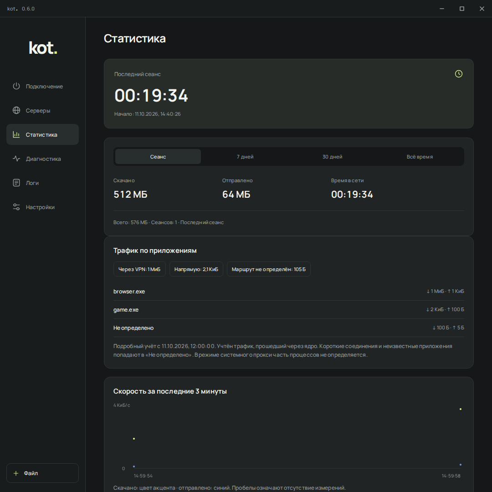

# Время подключения и статистика

Начиная с версии 0.6.0 ниже общих итогов показываются приложения и маршруты «Через VPN», «Напрямую» и «Маршрут не определён», график скорости последних трёх минут текущего сеанса, дневные итоги и график трафика за выбранный календарный период. Для «Всё время» график показывает последние 30 дней, а числовые итоги охватывают всю сохранённую историю.

Подробные счётчики сохраняются отдельно в `traffic-details.json`. Общие показатели из `traffic-history.json` сохраняются при обновлении; прошлый трафик нельзя задним числом распределить по приложениям. Дата начала подробного учёта показана на странице. Скоростной график хранится только для текущего процесса и очищается при новом подключении.

Ядро опрашивается раз в две секунды. Соединения, успевшие закрыться между опросами, и приложения без имени учитываются как «Не определено». Сумма подробных счётчиков сверяется с общим трафиком ядра. При позднем появлении соединения его доля ограничивается трафиком соответствующего интервала, поэтому распределение по приложениям следует считать оценкой. В режиме системного прокси приложения определяются не для всех соединений. Учитывается только трафик, прошедший через ядро, включая его прямые маршруты.

Открой раздел **Статистика** в меню слева или в меню значка приложения в трее. Здесь показан таймер текущего подключения. Он запускается после успешной проверки соединения и останавливается при отключении. Попытки соединения и ожидание сети не входят во время подключения. Каждый успешный запуск нового соединения, включая автоматическое переподключение, начинает новый сеанс. Смена выбранного узла внутри работающего ядра сама по себе не начинает новый сеанс.

В этом же разделе доступны четыре периода:

- **Сеанс:** скачано, отправлено, время подключения и число сеансов для текущего соединения. После отключения остаётся последний сеанс, в том числе после перезапуска приложения.
- **7 дней:** текущий календарный день и шесть предыдущих.
- **30 дней:** текущий календарный день и двадцать девять предыдущих.
- **Всё время:** все данные, накопленные после установки версии с этой функцией.

Дни определяются часовым поясом Windows. Это последние календарные дни, включая неполный сегодняшний день. Время подключения измеряется монотонными часами, поэтому перевод системных часов не меняет длительность сеанса. При переходе через полночь время распределяется между днями; прирост трафика между выборками распределяется пропорционально времени. Переход на летнее или зимнее время учитывает фактическую длину дня. Число сеансов для периода означает число успешных подключений, начавшихся в эти дни.

На снимке показаны демонстрационные данные браузерного теста, а не измерение реального VPN-соединения.

## Что измеряется

Скачивание и отправка берутся из общих счётчиков локального API sing-box, а не из суммы открытых соединений. Закрытие вкладки или завершение загрузки поэтому не убирает уже учтённый трафик. В статистику входят соединения, которые обрабатывает ядро: маршруты через VPN, маршруты напрямую и служебные проверки. Трафик приложений, обходящий sing-box, сюда не входит. Это не счётчик всего сетевого адаптера и не объём тарифицируемых оператором пакетов.

Используемые поля `downloadTotal` и `uploadTotal` определены в [исходниках sing-box 1.14.2](https://github.com/SagerNet/sing-box/blob/v1.14.2/experimental/clashapi/connections.go). Учёт закрытых соединений реализован в [менеджере трафика ядра](https://github.com/SagerNet/sing-box/blob/v1.14.2/common/trafficcontrol/manager.go). Клиент прибавляет только разницу с предыдущей выборкой для того же запуска ядра. Переподключение меняет поколение счётчиков и сбрасывает только статистику нового сеанса.

Выборки выполняются примерно каждые две секунды независимо от открытой страницы, паузы журнала и сворачивания в трей. Если API временно недоступен, накопленные значения сохраняются, а таймер продолжает работать при подтверждённом подключении. После восстановления API учитывается весь доступный прирост. При отключении клиент дополнительно пытается прочитать последние значения с ограничением ожидания в две секунды.

## Хранение истории

История сохраняется в `%LOCALAPPDATA%\KotVPN\traffic-history.json` отдельно от подписок. Файл содержит только даты, объёмы, длительности и число сеансов. Адреса сайтов, имена процессов, серверы и содержимое подписок в него не записываются. Смена или восстановление подписки не обнуляет историю; история не переносится с резервной копией настроек на другое устройство.

Сохранение выполняется каждые десять секунд во время подключения, а также при его начале и завершении. Сначала записывается временный файл и сбрасывается на диск, затем он атомарно заменяет предыдущий. При аварийном завершении могут потеряться последние несохранённые секунды и трафик после последней успешной выборки. После перезапуска прежний сеанс отображается как последний; его таймер не продолжает отсчёт.

Файл ограничен 64 КиБ. Хранятся до 32 дневных агрегатов, последний сеанс и отдельный общий итог. Очистка старых дневных записей не уменьшает счётчик за всё время. Исторические данные до появления этой функции восстановить невозможно; дата начала учёта доступна в подсказке карточки.

Если диск недоступен, клиент показывает сообщение и продолжает считать в памяти, повторяя попытку сохранения. Если существующий файл повреждён или его версия неизвестна, он остаётся нетронутым, а новый учёт работает только в памяти. Для начала новой истории закрой приложение, сохрани копию файла и переименуй `traffic-history.json`.

В браузерном демо счётчики имитируются и остаются только в памяти вкладки. Они не переживают перезагрузку демо и не обращаются к сети.
