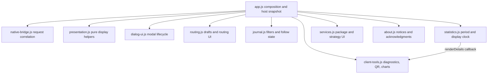

# UI ownership and design parameters

The approved UI remains plain HTML, CSS and JavaScript. No framework, bundler, dependency upgrade or alternate rendering tree is introduced. `Windows/ui/index.html` defines stable DOM IDs and loads classic scripts in dependency order. Native WebView2 and the isolated site demo consume the same files.

## Modules and data flow

Factories receive dependencies once from `app.js`: DOM lookup, `getModel`, `getPage`, RPC/request, toast and dialog callbacks where needed. `getModel()` always returns the latest host projection. Controllers keep only transient presentation state. No controller imports another page controller or writes the authoritative host snapshot.

`statistics.js` owns period selection and the confirmed connection display clock. `client-tools.js` receives the selected period when rendering charts and remembers the last rendered value for resize redraws. It does not call back into the statistics controller, avoiding a dependency cycle.

`native-bridge.js` owns request IDs, pending promises, deadlines and host message delivery. It knows no DOM or page implementation. `presentation.js` handles labels, country presentation and byte formatting without sending requests. `journal.js` owns pause/follow state and the paused snapshot. `routing.js` owns form drafts and renders native routing projections; actual matching/normalization remains in Core.

`app.js` still owns startup, navigation, subscriptions/server lists, connection projection and update presentation. These are explicitly deferred extraction candidates, not a second architecture hidden behind new wrappers. Existing `about.js`, `services.js`, `client-tools.js` and `dialog-ui.js` retain their responsibilities.

## Canonical styles

1. `styles/tokens.css` holds repeated approved values and theme overrides.
2. `styles/client.css` holds the original ordered rules, responsive exceptions, component states and keyframes.
3. `index.html` supplies structure; it no longer embeds the historical stylesheet blocks.

The extraction preserves selector specificity and cascade order. Late P5.1 overrides remain intentional until separately reviewed against visual baselines. More formatted CSS lines do not imply additional styling rules.

| Token group | Examples and contract |
| --- | --- |
| Theme | `--bg`, `--side`, `--surface`, `--raised`, `--line`, `--text`, `--muted`, `--accent`, `--ink`, `--detail`, `--danger`, `--back`; light values override the same names |
| Selected strategy | `--strategy-accent`, `--strategy-ink`, `--strategy-detail`; preserve the selected button's existing contrast in both themes |
| Type | `--font-ui`, body/caption/control/detail sizes, body/emphasis weights, body/control line heights |
| Spacing | `--space-xs/sm/md/lg`, `--dialog-pad`, `--section-gap` |
| Geometry | `--control-height` (40px), `--field-height` (42px), compact/control/panel/dialog radii |
| State | `--focus-ring`, `--opacity-disabled`, `--scale-press`; selectors determine when these apply |
| Motion | CSS fast/control/normal/surface durations; JS enter/exit/backdrop/help durations; `--ease` |
| Shadow | `--shadow-toast`; unique component shadows remain local |

The compact button radius is 8px; input/control radius is 9px. Keeping separate tokens preserves the actual design instead of forcing unrelated components to match. Change `--control-height` for standard button height, `--field-height` for fields, and the appropriate radius token for that component family. `Tests/architecture_ui.py` overrides these values and verifies multiple real component selectors in both themes.

JS animation duration tokens (`--motion-enter`, `--motion-exit`, `--motion-backdrop`, `--motion-help`) use **milliseconds** because Web Animations accepts numeric milliseconds. Keep their `ms` unit when editing. CSS transition tokens can use CSS time units. Startup artwork and unique page transitions retain local choreography; not every animation is a shared control token.

Responsive media queries remain in `client.css`; CSS variables cannot directly replace media-query conditions. Local illustration geometry, graphs, layout breakpoints and component-specific offsets are not global parameters. Do not tokenize every number or alter a breakpoint during a styling cleanup.

## Shared component behavior

Use existing `.primary`, `.quiet-button`, icon actions, dialog fields, switches and segmented controls before creating another component. Respect their active/pressed/disabled selectors and reserved label geometry. Theme state is applied to both root and body; token declarations belong at the root/theme level, not in a page controller.

`dialog-ui.js` coordinates native `<dialog>` behavior, focus return, dirty confirmation, validation and reduced motion. `app.js` owns the shared toast/popover and cancellation of its animations. Native errors go through these mechanisms; do not create independent alert overlays or report success before a confirmed snapshot.

Keep keyboard navigation, accessible labels, ARIA pressed/checked state and focus visibility. Use text nodes for names/errors and the bundled country flag allowlist. Long subscription text must not become HTML, URLs or file paths.

## Site and packaging

`site/build.py` copies the complete canonical UI tree and aliases `app.js` to the demo's `client.js`. `site/check.py` verifies copied JavaScript parity and referenced assets. The demo adds `site/demo/bridge.js` before the app entry point and supplies synthetic state. Its sandbox/CSP prohibits native operations and network connections.

The demo embeds the existing bundled font as a data URI inside the copied stylesheet to work within its opaque sandbox origin. The native stylesheet uses the relative bundled font path. Landing-page typography and components in `site/scripts` remain independent; the demo is the shared client UI, not a manually maintained copy.

Windows publishing includes `ui/**`. Any new script/style must be referenced in the correct load order and verified in published/installed assets. Keep development tools and private fixtures outside that tree.

## Safe extension checklist

Locate the current owner, add the smallest controller behavior with explicit dependencies, and extend native/demo/fixture contracts together if necessary. Reuse tokens and components, preserve IDs and pending/error/cancel semantics, then run the affected suites and visual comparison described in [VALIDATION.md](VALIDATION.md). A browser mock proves presentation behavior only.
