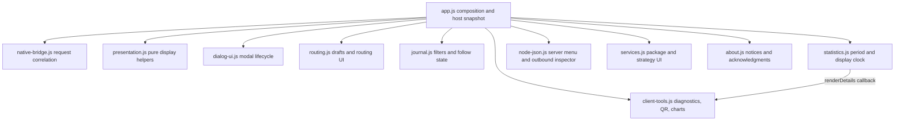

# UI ownership and design parameters

The approved UI remains plain HTML, CSS and JavaScript. No framework, bundler, dependency upgrade or alternate rendering tree is introduced. `Windows/ui/index.html` defines stable DOM IDs and loads classic scripts in dependency order. Native WebView2 and the isolated site demo consume the same files.

## Modules and data flow

Factories receive dependencies once from `app.js`: DOM lookup, `getModel`, `getPage`, RPC/request, toast and dialog callbacks where needed. `getModel()` always returns the latest host projection. Controllers keep only transient presentation state. No controller imports another page controller or writes the authoritative host snapshot.

`statistics.js` owns period selection and the confirmed connection display clock. `client-tools.js` receives the selected period when rendering charts and remembers the last rendered value for resize redraws. It does not call back into the statistics controller, avoiding a dependency cycle.

`native-bridge.js` owns request IDs, pending promises, deadlines and host message delivery. It knows no DOM or page implementation. `presentation.js` handles labels, country presentation and byte formatting without sending requests. `journal.js` owns pause/follow state and the paused snapshot. `routing.js` owns form drafts and renders native routing projections; actual matching/normalization remains in Core.

`app.js` still owns startup, navigation, subscriptions/server lists, connection projection and update presentation. These are explicitly deferred extraction candidates, not a second architecture hidden behind new wrappers. Existing `about.js`, `services.js`, `client-tools.js` and `dialog-ui.js` retain their responsibilities.

Ping-only snapshots update the existing row's ping label and attributes in place. They must not detach the row, its menu anchor or its controls: rebuilding those elements resets Chromium hover colours and running transitions. Only the requested node's pending/queued/checking button is disabled; the card, menu and other nodes remain interactive. A transient request set covers the gap before native acceptance without inventing a completed result. `PingService` retains the single owner and queues distinct individual requests behind the active batch, suppressing duplicates per node; cancellation and profile/settings cleanup drain that same queue.

Both VPN buttons render the same host connection snapshot and share the `toggle` request. The sidebar shows progress during connection and disconnection. The home button can still cancel a connection attempt. The sidebar tooltip follows the selected server, including the resolved server in Auto mode.

The server JSON inspector requests full outbound data only when explicitly opened. It keeps the response in its own code region, never in the common snapshot, storage or diagnostics; closing clears it. Copy sends only the node/view and revision to the host, which checks that the entire displayed JSON still matches before writing the clipboard. Stale replies are ignored after switching or closing. Both representations use the same disclosure behavior.

The inspector keeps a 620px maximum width and height with 32px viewport clearance. This local geometry belongs to the reading task, not a global dialog token. Its fixed panel has a shrinking scroll region and a separate bottom row inside the border for the standard copy button and status. Loading, unavailable data and errors stay inside that region. Both themes use existing tokens; Chromium checks bounds, per-frame stability, two-axis scrolling, theme/scale changes and focus.

The server action popup remains owned by `node-json.js`. It receives the shared `animate` and `cancelMotion` callbacks from `app.js`; actions still call the existing JSON and QR handlers. Like the subscription picker, this is a compact nonmodal popup anchored to its trigger. It uses that family's 200ms `--motion-exit` for both directions, `--ease`, 4px translation and `.985` scale, rather than the larger dialog's 280ms entry. These local offsets are not new global tokens. The trigger is the fixed visual reference; the whole popup moves as one surface. Upward placement reverses the translation and transform origin.

On reversal it captures the rendered pose before cancellation. A generation check prevents an old completion from hiding a reopened popup. Closing immediately disables hit testing and focus within the layer; Escape returns focus, Tab continues from the trigger, and outside clicks preserve their destination. Reduced motion, external hiding, navigation, scrolling and resizing finish cleanup without waiting for animation. Intrinsic width and fractional zoom-aware coordinates keep the right anchor stable. Borderless full-width rows share one `1px solid var(--line)` separator, `--raised` interaction feedback and the existing inset focus-ring pattern. No server data is requested merely by opening the menu.

## Canonical styles

1. `styles/tokens.css` holds repeated approved values and theme overrides.
2. `styles/client.css` holds the original ordered rules, responsive exceptions, component states and keyframes.
3. `index.html` supplies structure; it no longer embeds the historical stylesheet blocks.

The extraction preserves selector specificity and cascade order. Late P5.1 overrides remain intentional until separately reviewed against visual baselines. More formatted CSS lines do not imply additional styling rules.

| Token group | Examples and contract |
| --- | --- |
| Theme | `--bg`, `--side`, `--surface`, `--raised`, `--line`, `--text`, `--muted`, `--accent`, `--ink`, `--detail`, `--danger`, `--back`; light values override the same names |
| Selected strategy | `--strategy-accent`, `--strategy-ink`, `--strategy-detail`; preserve the selected button's existing contrast in both themes |
| Type | `--font-ui`, body/caption/control/detail sizes, body/emphasis weights, body/control line heights |
| Spacing | `--space-xs/sm/md/lg`, `--dialog-pad`, `--section-gap` |
| Geometry | `--control-height` (40px), `--field-height` (42px), compact/control/panel/dialog radii |
| State | `--focus-ring`, `--opacity-disabled`, `--scale-press`; selectors determine when these apply |
| Motion | CSS fast/control/normal/surface durations; JS enter/exit/backdrop/help durations; `--ease` |
| Shadow | `--shadow-toast`; unique component shadows remain local |

The compact button radius is 8px; input/control radius is 9px. Keeping separate tokens preserves the actual design instead of forcing unrelated components to match. Change `--control-height` for standard button height, `--field-height` for fields, and the appropriate radius token for that component family. `Tests/architecture_ui.py` overrides these values and verifies multiple real component selectors in both themes.

JS animation duration tokens (`--motion-enter`, `--motion-exit`, `--motion-backdrop`, `--motion-help`) use **milliseconds** because Web Animations accepts numeric milliseconds. Keep their `ms` unit when editing. CSS transition tokens can use CSS time units. Startup artwork and unique page transitions retain local choreography; not every animation is a shared control token.

The startup cover uses `loading-ui.js` and its fixed 72px SVG slot. `Tools/loading_motion.py` generates one 120Hz catalog consumed as JSON by `Windows/LoadingMotion.cs` and as a classic script by the web owner. The original Manrope 800 k contour and period proportions remain rigid. Positions are interpolated by elapsed milliseconds, not accumulated per frame. The square's flight uses constant gravity, rollover uses corner torque, grounded rocking preserves the supporting corner, and the letter reacts only at contact. These local physical trajectories are not control easing tokens.

The native host sends its already-chosen sequence and elapsed-time origin before releasing the cover. Both renderers sample the same sequence. Existing entrance/exit durations and curves remain unchanged; no loader waits for a gesture to finish before accepting readiness. `app.js` disposes the owner in startup cleanup. The component stops RAF on hidden document, intersection, native host minimize/tray visibility or reduced motion; the native artwork stops its timer and elapsed clock on hide/minimize. Remaining loading states are not invented from animation progress.

The first gesture is quiet. Subsequent full-size choices use catalog weights 75/20/4.5/0.5 percent; jokes cannot repeat within one sequence. Compact sequences use calm gestures only. After 64 choices a very long operation uses quiet breathing indefinitely. Manually changing demo gestures queues the next choice until the current gesture reaches its resting boundary. Completing a loading operation never waits for that boundary.

The large sidebar logo still owns the existing 443-click cycle. Click 47 plays the exclusive `protest` scene through the original period span; it is absent from all loading pools. It adds no click target, sound, hint, focus transfer or counter reset. Click 443 retains the original meow and resets the cycle. Reduced motion cancels the scene and restores the period. `Tools/loading_demo.py` creates a separate self-contained review page, not a hidden production feature.

Responsive media queries remain in `client.css`; CSS variables cannot directly replace media-query conditions. Local illustration geometry, graphs, layout breakpoints and component-specific offsets are not global parameters. Do not tokenize every number or alter a breakpoint during a styling cleanup.

## Shared component behavior

Use existing `.primary`, `.quiet-button`, icon actions, dialog fields, switches and segmented controls before creating another component. Respect their active/pressed/disabled selectors and reserved label geometry. Theme state is applied to both root and body; token declarations belong at the root/theme level, not in a page controller.

`dialog-ui.js` coordinates native `<dialog>` behavior, focus return, dirty confirmation, validation and reduced motion. `app.js` owns the shared toast/popover and cancellation of its animations. Native errors go through these mechanisms; do not create independent alert overlays or report success before a confirmed snapshot.

An accepted modal close normally awaits both surface and backdrop `finished` promises. It also owns a rendering-independent completion deadline derived from the maximum finite effect end time: one span for start/notification scheduling and one for playback. Each original `ready` promise may extend that deadline once to cover its actual remaining playback. This preserves a late-starting normal transition without an indefinitely renewable timer. Paused effects, missing finish notifications and suppressed iframe rendering cannot retain modality indefinitely while JavaScript tasks run. A frozen or blocked JS thread can only clean up after execution resumes. This is a lifecycle bound, not an animation duration or an RPC deadline.

Every completion checks the state identity, generation and finalized flag. Reopening invalidates and clears the old timer; finalization removes effects, timer and stack membership once. Partial animation creation cancels already-created effects and uses the static target state without exposing errors or payloads in logs. Dirty confirmation still precedes acceptance of a close. Focus restoration verifies actual focus success and selects an available fallback in the current modal layer or visible page. If hidden rendering rejects every attempt, one animation-frame retry may restore otherwise unassigned BODY focus. The retry requires the same finalized session/generation and document focus, is canceled on reopen, and never overrides a newer focused control or another document. It is independent of RPC completion and never delays releasing modality. Advanced/HWID cleanup ignores old native close events while a new session is open; a fresh advanced session resets the previous HWID attempt before requesting new data.

Keep keyboard navigation, accessible labels, ARIA pressed/checked state and focus visibility. Use text nodes for names/errors and the bundled country flag allowlist. Long subscription text must not become HTML, URLs or file paths.

## Site and packaging

`site/build.py` copies the complete canonical UI tree and aliases `app.js` to the demo's `client.js`. `site/check.py` verifies copied JavaScript parity and referenced assets. The demo adds `site/demo/bridge.js` before the app entry point and supplies synthetic state. Its sandbox/CSP prohibits native operations and network connections.

The demo embeds the existing bundled font as a data URI inside the copied stylesheet to work within its opaque sandbox origin. The native stylesheet uses the relative bundled font path. Landing-page typography and components in `site/scripts` remain independent; the demo is the shared client UI, not a manually maintained copy.

Windows publishing includes `ui/**`. Any new script/style must be referenced in the correct load order and verified in published/installed assets. Keep development tools and private fixtures outside that tree.

## Safe extension checklist

Locate the current owner, add the smallest controller behavior with explicit dependencies, and extend native/demo/fixture contracts together if necessary. Reuse tokens and components, preserve IDs and pending/error/cancel semantics, then run the affected suites and visual comparison described in [VALIDATION.md](VALIDATION.md). A browser mock proves presentation behavior only.

Физика, геометрия и жизненный цикл фирменной точки описаны в [LOADING-MOTION.md](LOADING-MOTION.md).
