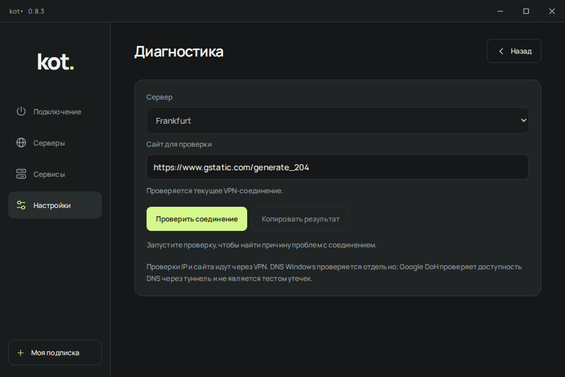
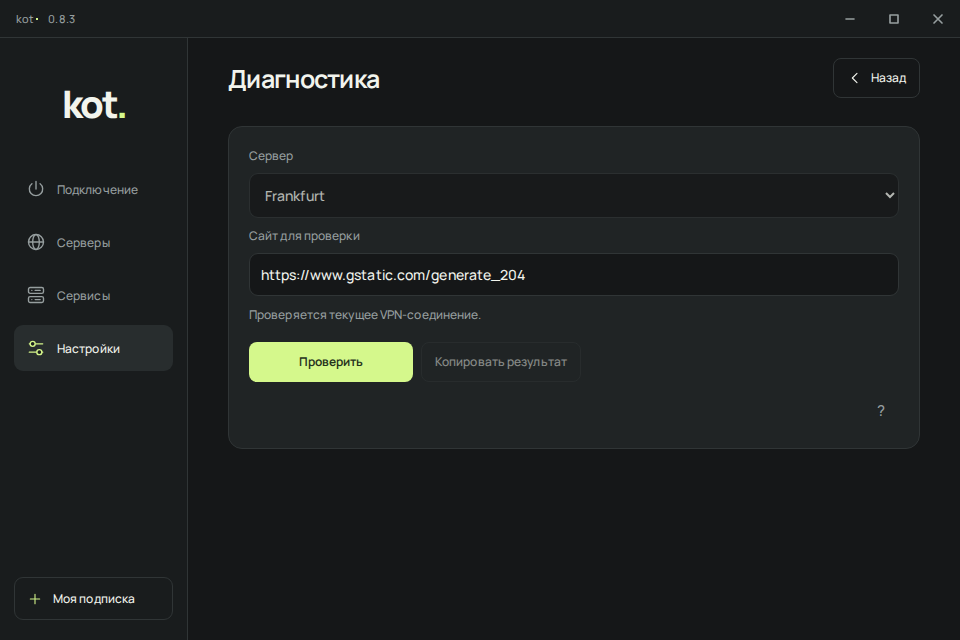
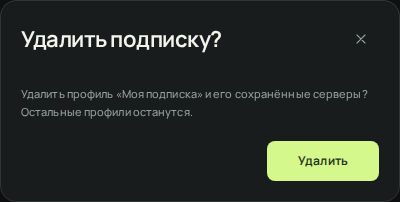
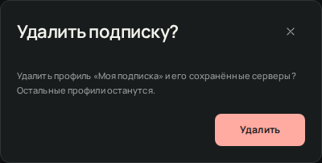

# Повторная проверка переноса P5.1 в kot 0.8.3

Проверка выполнена после исправления сдвига значка пинга в `ffb31df`.
Основа сравнения: утверждённый `kot-ui-handoff-p51`, его UI_SPEC, ACCEPTANCE,
MOTION, 21 замечание из RESOLUTIONS и сам автономный прототип.
Проверяется интерфейс реального клиента из `Windows/ui`, не новый макет.

## Найдено и исправлено

| Место | Что было пропущено | Исправление |
|---|---|---|
| Формы | После ошибочного ввода, отказа от изменений и повторного открытия оставались старый текст ошибки и `aria-invalid`, хотя значение уже сброшено на правильное | Новая сессия формы очищает только свою валидацию. Возврат из подтверждения закрытия сохраняет черновик и ошибку. Чужие описания и новые ошибки операции не стираются |
| Удаление подписки, маршрутов, сервиса | Кнопки оставались зелёными, как обычное главное действие | Цвет удаления из палитры P5.1, читаемый текст в обеих темах. Первоначальный фокус остаётся на безопасном действии |
| Встроенные кнопки справки | Область нажатия 28 x 28 вместо 36 x 36 | Единая область 36 x 36, доступное имя, клавиатура и Escape |
| Диагностика | Длинное постоянное техническое пояснение и лишняя подсказка в пустом состоянии | Подробности доступны по `?`. Текущий режим проверки, реальные результаты и ошибки остаются видимыми |
| Диагностика и проверка соединения | Подпись не показывала выполнение, повтор учитывал не все завершённые состояния | `Проверить`, `Проверка…`, `Проверить ещё раз`. Учитывается именно текущая операция и ожидание RPC, ширина действия 164 px |
| Обновление клиента | Во время загрузки и проверки подписи оставалось приглашение обновиться | `Обновление…` во время реальной операции, `Повторить` при ошибке. Сохранены отмена, продолжение загрузки после закрытия и фактический прогресс |
| QR сервера | Действия использовали старую левую компоновку | Общая правая линия и интервалы действий диалога. Копирование ссылки, QR и сохранение PNG остаются нативными |
| Кнопки, ссылки, маленькое окно | Оставались старые размеры отдельных кнопок, зазоры ссылок настроек, оформление ссылки проекта сервиса | Высота обычных действий 40 px, компактных действий серверов 36 px, короткие подписи и единые интервалы. При высоте до 680 px восстановлены отступы и радиусы P5.1 |
| Маршрутизация и автоматизация | Пояснение о применении маршрутов было после действий; смысл нулевого интервала был только в справке | Последствия находятся перед действиями. Значение `0` поясняется рядом с настройками |
| Справка и смена темы | Справка могла оставаться у старой позиции при прокрутке владельца; фон шкалы не имел плавного перекрашивания | Прокрутка владельца закрывает справку без переноса фокуса. Прокрутка самой справки её не закрывает. Шкала перекрашивается вместе с остальным интерфейсом |

Основные файлы: [разметка и стили](../../Windows/ui/index.html),
[формы и справка](../../Windows/ui/dialog-ui.js),
[диагностика и проверка](../../Windows/ui/client-tools.js),
[состояния обновления](../../Windows/ui/app.js),
[регрессионные проверки](../../Tests/ui_p51.py).

Снимки производственного HTML/JS с одинаковыми искусственными данными и версией
0.8.3, до исправлений из этого прохода и после них:

| Экран | До | После |
|---|---|---|
| Диагностика |  |  |
| Удаление подписки |  |  |

## Объём сверки

Сравнение сделано при одинаковом размере 960 x 640 CSS px, без панели рецензирования
прототипа. Для проверок производственного UI используются синтетические ответы
того же формата, что реальные RPC/snapshots. Это не доказательство работы VPN.
Различия данных, например названия серверов, версия, состояние соединения,
реальный HWID или QR, не считаются пропусками дизайна.

| Группа | Проверенные экраны |
|---|---|
| 7 страниц | Подключение, серверы, статистика, диагностика, журнал, сервисы, настройки |
| Подписки и подключение | Добавление, редактирование, удаление, параметры пинга, проверка соединения, QR |
| Настройки | Дополнительно, устройство и HWID, автоматизация, резервная копия, обновления |
| Маршрутизация | Профиль, импорт, удаление, GeoIP |
| Сервисы | Настройки zapret, настройки Telegram, подбор стратегии, удаление сервиса, смена ключа |
| Остальные окна | О приложении, изображение |

Всего 22 варианта окон. Подтверждение закрытия несохранённых форм и справка
проверяются дополнительно. Существующие тесты покрывают три последовательных
открытия каждого варианта, прерывание анимаций, повторное открытие, фокус,
меню подписок, состояния пинга, уведомления, уменьшение движения, отмену
и ошибки реальных по формату операций.

Новые проверки воспроизводят оставшуюся ошибку валидации, проверяют подписи
ожидающих/выполняющихся/завершённых операций, геометрию действий при длинных
ошибках и 20 результатах проверки, доступность справки, её закрытие при
прокрутке, контраст удаления не ниже 4.5:1, сохранение связей `aria-describedby`
и ввод при отказе RPC. Проверка размеров выполняется и для самого значка пинга,
а не только внешней кнопки.

Матрица `ui_resilience.py`: обе темы, 800 x 600, 960 x 640, 1280 x 800,
длинные строки, 120 серверов, browser DPR 1/1.25/1.5/2.
Команды полного набора и ссылки на исходные снимки находятся в [README](README.md).
Результаты текущей ревизии смотри в [PR #51](https://github.com/prodkot/kot/pull/51).

Локальный результат этого прохода: все 13 наборов тестов клиентского UI,
проверки сайта и браузерного демо, `repository.py`, `release_ref.py` и
`xray_source.py` прошли. Нативные проверки и сборка установщика выполняются
отдельно в GitHub Actions на Windows; их результат привязан к commit в PR.

## Дополнение: выбор результата zapret

В результатах подбора выбранная стратегия не участвовала в ключе перерисовки,
а все кнопки всегда оставались с подписью «Выбрать». Сохранение уже работало,
но интерфейс не показывал его результат.

- Рекомендация из `StrategyTestRun.Recommended` выделена зелёной кнопкой и
  отметкой «Лучший результат». Алгоритм оценки не изменён; без рекомендации
  зелёной кнопки нет. Цвет остаётся зелёным при другом акценте интерфейса.
- `services.zapret.strategy` определяет нажатое состояние, галочку и «Выбран».
  Изменение через список стратегий и новые снимки приложения обновляют ту же
  отметку. Рекомендация и сохранённый выбор могут относиться к разным строкам.
- Во время RPC показано «Сохранение…», повторные запросы заблокированы.
  Ошибка сохранения оставляет прежний выбор, показывает сообщение и разрешает
  повторить попытку. Откат значения выпадающего списка работает и при фокусе.
- Ширина кнопки постоянна. Обновления выбора и занятости не пересоздают строки,
  поэтому сохраняются фокус и раскрытые подробности проверок.
- «Выбран» означает сохранённую настройку. Когда zapret работает, сохраняется
  прежний запрос перезапуска. Его фактическое состояние и возможная ошибка
  продолжают отображаться отдельно, успешный запуск не имитируется.

[Обработчики и состояния](../../Windows/ui/services.js),
[стили](../../Windows/ui/index.html),
[регрессии](../../Tests/services_ui.py).
Проверки в Chromium с искусственным RPC покрывают отложенный ответ, быстрые
нажатия, ошибку и повтор, выбор через список, состояние при сбое перезапуска,
недоступные старые стратегии, отсутствие рекомендации, клавиатуру, геометрию
и обе темы при ширине 800/960/1080. Реальную доступность адресов у пользователя
эти проверки не измеряют.

## Границы проверки

В этом проходе изменены только HTML/CSS/JS интерфейса, тесты и описание версии.
Сетевое ядро, RPC-контракты, VPN, TUN, DNS, Kill Switch, автозапуск,
установщик и хранение пользовательских данных не менялись. Значения и результаты
продолжают приходить из приложения; таймеры демонстрации не перенесены.

Linux/Chromium не заменяет установленный WebView2 на твоём ПК. Отдельной проверки
в Windows по-прежнему требуют масштабирование 100/125/150%, перенос между
мониторами, прежняя жалоба на самопрокрутку настоящего списка серверов и вид
окон с реальными данными. Нативные проверки Windows в CI имеют собственные
результаты и не выдаются за проверку твоего компьютера.

Версия остаётся 0.8.3. PR не сливается, публичный релиз не создаётся.
