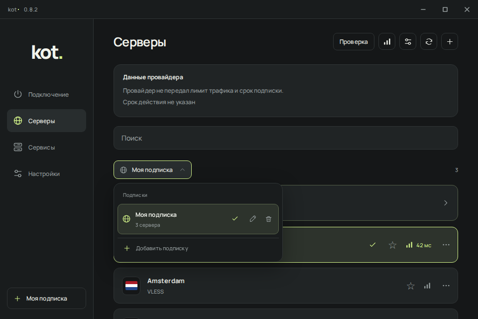
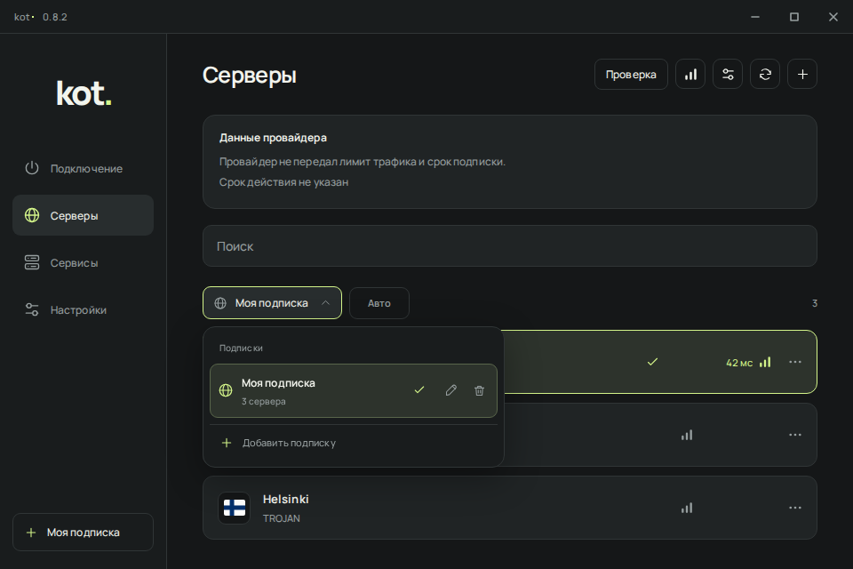
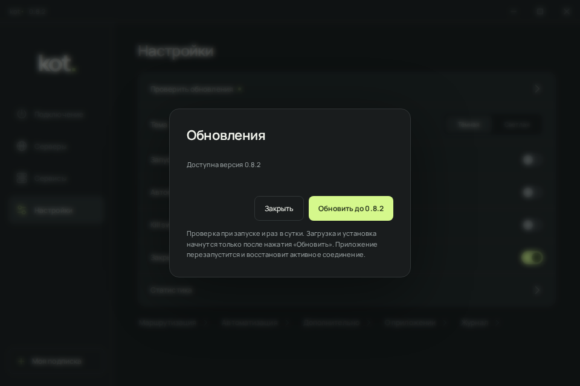
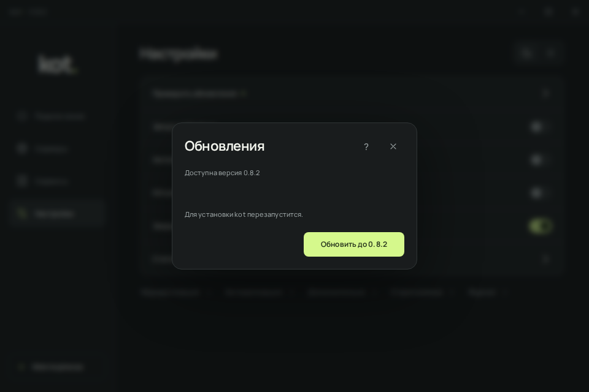
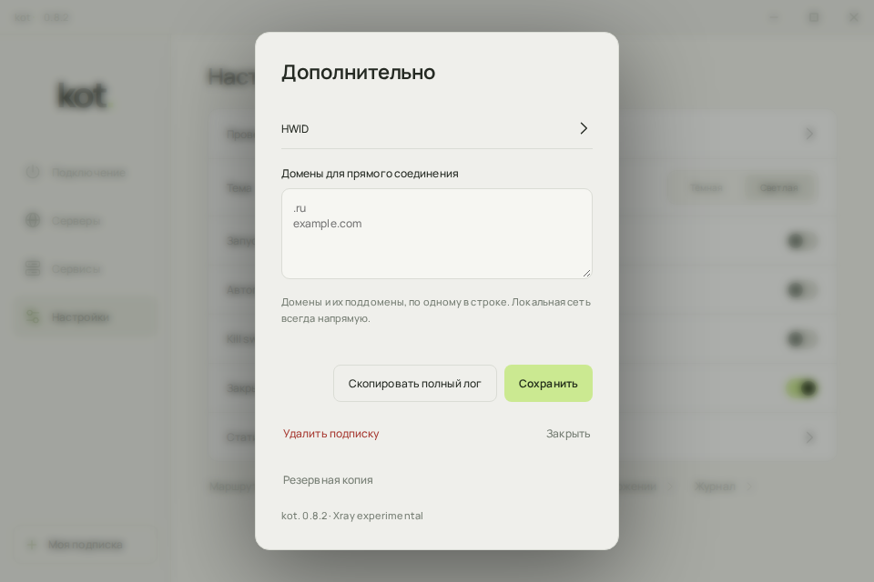
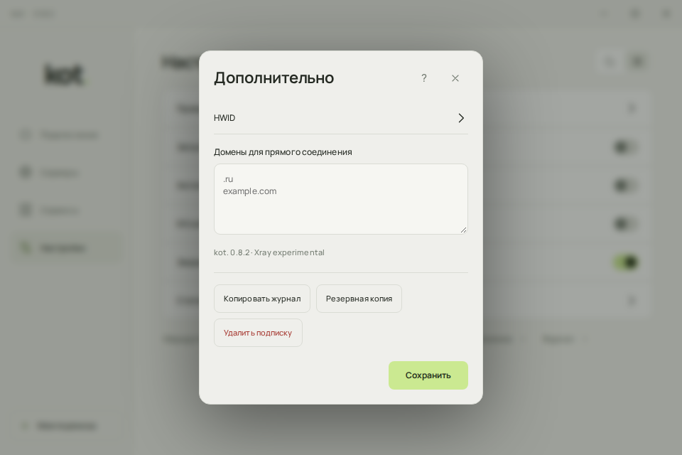
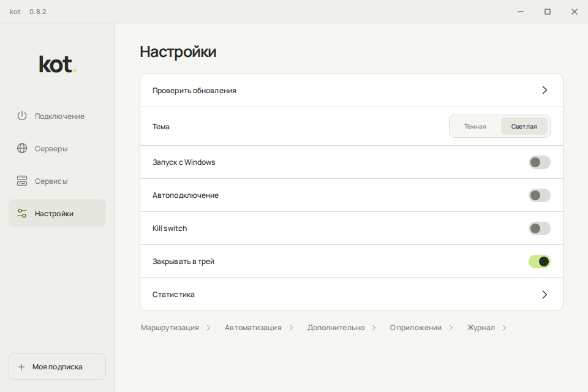
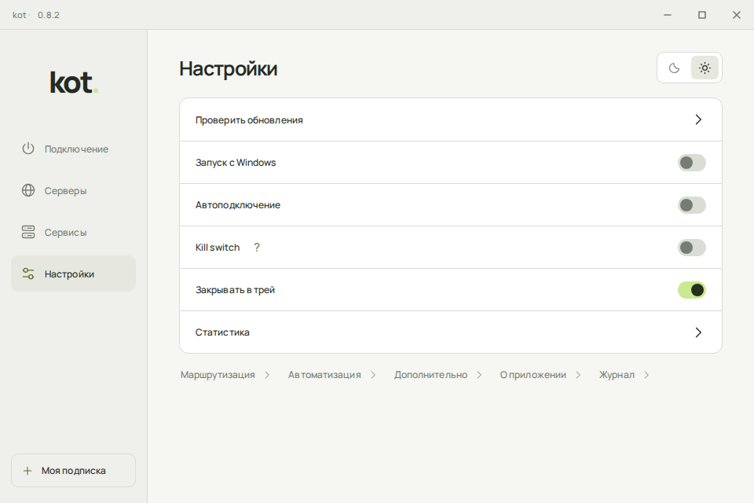
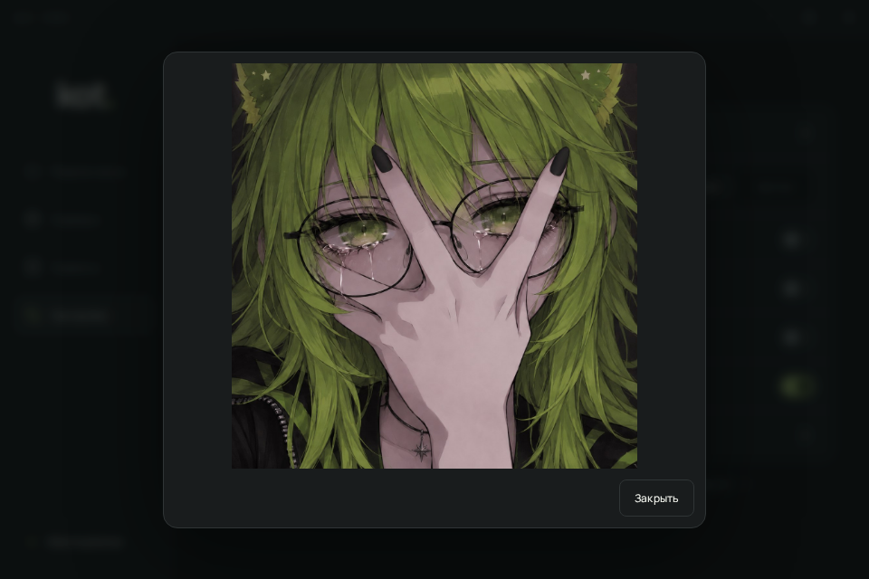

# Windows UI polish P5.1

Port of the approved P5.1 handoff into `Windows/ui`, based on current main
`dd6ea519c4c894c56dc680bd28a27824e55d7f8d`. The test installer version is **0.8.3**.

## Scope

- Shared dialog spacing, scrollable bodies, header close/help controls and keyboard focus.
- Confirmation for unsaved form input, safe default action and preserved failed-save drafts.
- Compact Auto selection, hidden favorite controls with stored favorites/API retained, stable ping/QR columns.
- Subscription menu anchored to the stationary profile container during press, entry and exit.
- Update progress uses actual snapshot bytes/size. Unknown size stays indeterminate; closing the window does not cancel the download.
- Consistent quality-check actions, service tabs, theme controls, checkboxes, image viewer and support actions.
- Entry/exit cleanup, repeated Escape, interrupted/reopened dialogs and reduced motion.

The new `dialog-ui.js` owns presentation and dismissal only. Existing RPC handlers,
validation, operation/session guards and native `close` cleanup remain in their
owning modules. The native VPN, TUN, DNS, Kill Switch, reconnect, updater and service
implementations are unchanged. No prototype bridge, sample results, review toolbar
or animation laboratory is shipped. The original nested HWID Back/Escape behavior
is retained.

The existing website demo reuses these production assets. Its build includes the
new dialog module, and its isolated bridge/help selectors and browser assertions
follow the updated markup. The demo remains sandboxed and cannot perform real
networking, installations or updates.

## Before / after

These are screenshots of the **production HTML/JS rendered in Chromium**, with the
same synthetic RPC snapshots, 960 x 640 CSS-pixel viewport, DPR 1 and reduced motion.
They are not screenshots of a real connected Windows client. Fixture server names,
ping values and version availability illustrate presentation only. Before comes
from the base commit above; after comes from this change. Real runtime values still
come from the application. P5.1 was also inspected at the same viewport with the
prototype review toolbar removed from the comparison.

| Screen | Before | After |
|---|---|---|
| Servers/menu, dark |  |  |
| Updates, dark |  |  |
| Advanced, light |  |  |
| Settings, light |  |  |
| Image viewer, dark |  |  |

## Automated checks

The existing `Windows checks` PR workflow retains the repository, browser, core,
Xray integration, native Windows process/window/WebView2 and managed-service jobs.
It additionally runs `python3 Tests/ui_p51.py`. Check the PR status for the actual
result of those jobs; browser tests do not certify native networking.

Local Chromium checks:

```sh
python3 Tests/repository.py
python3 Tests/ui.py
python3 Tests/journal_ui.py
python3 Tests/flags_ui.py
python3 Tests/subscriptions_ui.py
python3 Tests/routing_ui.py
python3 Tests/statistics_ui.py
python3 Tests/client_tools_ui.py
python3 Tests/services_ui.py
python3 Tests/ui_controls.py
python3 Tests/about_ui.py
python3 Tests/ui_polish.py
python3 Tests/ui_resilience.py
python3 Tests/ui_p51.py
python3 site/check.py
python3 site/demo_browser_check.py
```

`ui_p51.py` exercises dirty forms, errors/retry/success, three cycles of each of
22 dialog variants (including both services and nested HWID), interrupted reopening,
native dismissal cleanup, focus/help, long subscription names, short/180/400 ms
presses, intermediate menu X coordinates (0.02 CSS px tolerance), upward/downward
placement, resize/scroll dismissal, all ping states, real-byte-shaped progress,
stable action positions, failed clipboard replies and reduced motion during exit.

The first ping originally moved the signal icon 88 CSS pixels at 960 x 640:
an empty result span was hidden, so Grid auto-placed the icon in the text column.
The port now retains the prototype's explicit column/row for both children.
The regression check measures the icon itself, the button and adjacent menu before
any result and through queued/checking/success/error/unsupported/cancelled/cleared
states, in both themes at widths 640, 800, 960 and 1280. The earlier check measured
only the button width and menu position and therefore missed this movement.

`ui_resilience.py` covers all seven pages and 22 dialog variants, long values and
errors, both themes, 800 x 600 minimum geometry and additional browser DPR values.
The existing interaction tests retain RPC, cancellation, secret/QR cleanup, audio,
keyboard, focus and delayed-reply assertions. Changed expectations cover intentional
P5.1 behavior (hidden favorites, retained disabled update button, 200 ms dismissal
and 300 ms power-button return).

## Still requires Windows acceptance

The [full follow-up review](FULL-REVIEW.md) records the remaining P5.1 differences
found after the first-ping fix, the corrections and the additional regression
coverage. It covers the seven pages and all 22 dialog variants against the
production UI. See the PR checks for validation of the current revision.

- Physical Windows display scaling at 100%, 125% and 150%, including moving between monitors.
- The reported unwanted Windows list scrolling during real server snapshots.
- Visual review of the full new dialog inventory in the installed WebView2 client.
- Real subscription/VPN lifecycle and update/reconnect acceptance on a test machine.

Browser DPR checks are not a replacement for these checks. Existing native CI
covers a subset of WebView2, window/tray and service behavior, not this full manual
matrix. This is a reviewable UI PR, not a release approval; no tag or release is included. Version 0.8.3 is prepared for testing
through the Windows development build.
